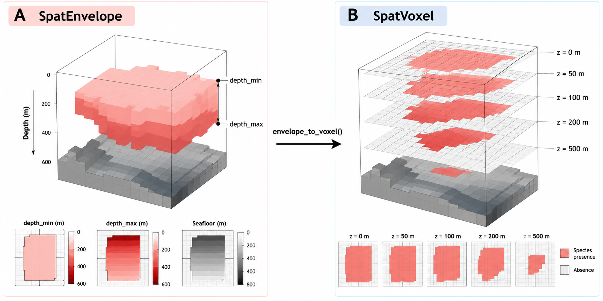

# ocean3d

<!-- badges: start -->
[](https://github.com/Marine-Biodiversity-Conservation-Lab/ocean3d/actions?query=workflow%3Apkgcheck)
[](https://github.com/Marine-Biodiversity-Conservation-Lab/ocean3d/actions/workflows/R-CMD-check.yaml)
[](https://app.codecov.io/gh/Marine-Biodiversity-Conservation-Lab/ocean3d)
[](https://www.repostatus.org/#wip)
<!-- badges: end -->

**ocean3d** is an R package for three-dimensional marine spatial
analysis of species ranges, fisheries, and depth-stratified
oceanographic data. It grew out of work on sharks, rays, and chimaeras,
with the functions generalising to any marine taxon or spatial layer.

The three-dimensional marine environment poses a unique challenge for
spatial analyses. Most conventional GIS workflows represent space as a
two-dimensional plane. This abstraction fails to capture the range of
depths and vertical overlap of marine habitat. Fisheries also operate at
different depths depending on gear type and target species, creating
depth-specific patterns of threat exposure that require analysis in 3D
volume rather than 2D planes to quantify. `ocean3d` provides
documented workflows and reusable functions for:

- extracting values from depth-stratified oceanographic rasters within
  user-defined geographic areas and depth windows;
- characterising the abiotic habitat (e.g., temperature, dissolved
  oxygen) of marine species using IUCN Red List ranges and World Ocean
  Atlas 2023 climatologies;
- calculating three-dimensional overlap between species distributions,
  fisheries effort, and other spatial layers;
- producing depth-aware maps and depth-profile plots of species ranges,
  environmental conditions, and cumulative fishing pressure.

## How it works

Species ranges and other spatial layers are usually stored as 2D maps, but
marine species and activities also occupy a depth range, bounded by the
seafloor. `ocean3d` combines a 2D range, a depth range, bathymetry and
gridded environmental data into one 3D representation, so you can ask, for
example, which temperatures occur within a species' 3D distribution.


In order to represent the 3D space in the ocean, we use a stacked-raster approach built on `terra`. We call this the Spatial Voxel Model, with the class `SpatVoxel`. Using this `SpatVoxel`, we can represent any number of spatial phenomena in the ocean, including species distributions, fishing effort, and oceanographic variables. 

`ocean3d` uses two representations for 3D geometry: A `SpatEnvelope` stores one 
continuous `[depth_min, depth_max]` interval per cell; a `SpatVoxel` stores a 
value at each of a set of depth levels, so it can hold a variable and interior gaps.
`SpatEnvelope` is useful for representing discrete 3D geometry (ex. species ranges 
with defined boundaries for area and depth). In contrast, `SpatVoxel` is ideal for 
representing continuous values (ex. species distribution models with probabilities 
of occurrence, rather than presence and absences). `SpatVoxel` can also represent 
overhangs, holes, etc. in 3D space since it contains a value for every depth, rather than a depth range. 



This package includes functions for converting common vector representations
to these 3D representations. For example, `vect_to_envelope()` turns a
species range polygon and its observed depth range into a `SpatEnvelope`
bounded by the seafloor, and `envelope_to_voxel()` places it on the depth
levels of a `SpatVoxel`, as in the figure above.

This package includes utilities for working with commonly used datasets in
marine habitat spatial analyses, including IUCN Red List, World Ocean Atlas, 
GEBCO, Copernicus Marine, and Global Fishing Watch. 

## How ocean3d relates to other packages

Several R packages and other tools already handle depth or 3D data.
`ocean3d` builds on some of them and adds 3D spatial queries for gridded
marine data: which cells and depths a species, fishery or other layer
occupies, where two of them overlap in 3D, and what environmental values
fall inside.

| Tool | What it does | How `ocean3d` relates |
|---|---|---|
| [terra](https://rspatial.github.io/terra/) | Raster and vector analysis. A multi-layer `SpatRaster` can record one depth per layer with `terra::depth()`. | `SpatVoxel` and `SpatEnvelope` are `SpatRaster`s, so terra functions still work on them. `ocean3d` adds the depth-aware operations terra doesn't have (see below). |
| [sf](https://r-spatial.github.io/sf/) | 2D vector geometry and spatial queries (buffers, clips, intersections). | Polygons such as species ranges enter `ocean3d` as `sf` or terra objects and are given a depth range with `vect_to_envelope()`. |
| [stars](https://r-spatial.github.io/stars/) | Arrays with any number of dimensions (data cubes), including depth and time. | Compared with terra, ncdf4 and ncdfCF in a trial ([#112](https://github.com/Marine-Biodiversity-Conservation-Lab/ocean3d/issues/112); [`dev/data-model-trial.md`](dev/data-model-trial.md)). The planned data model ([#99](https://github.com/Marine-Biodiversity-Conservation-Lab/ocean3d/issues/99)) uses stars only to read remote Zarr stores. stars has no class for a per-cell depth range, and no 3D intersect or volume. |
| [ncdf4](https://cran.r-project.org/package=ncdf4), [CFtime](https://cran.r-project.org/package=CFtime) | Read netCDF files and decode CF time. | Used by the netCDF extraction functions, which read only the cells each observation needs. |
| [rgl](https://dmurdoch.github.io/rgl/), [rayshader](https://www.rayshader.com/) | 3D visualisation. | `ocean3d` doesn't draw in 3D. Its outputs are rasters and tables that these packages can plot. |
| [lidR](https://r-lidar.github.io/lidRbook/), [rTLS](https://github.com/Antguz/rTLS) | 3D point clouds from LiDAR and terrestrial laser scanning. | Built for dense point clouds of land surfaces and vegetation, not for gridded ocean data with depth levels and a seafloor. |
| [PostGIS](https://postgis.net/docs/PostGIS_Special_Functions_Index.html#PostGIS_3D_Functions) | 3D functions on vector geometry in a PostgreSQL database. | Works outside R on vector geometry in a database. `ocean3d` works in R on gridded data with depth levels. |

### What terra doesn't do on its own

terra can record the depth of each layer, but its functions treat the
layers as a stack: they don't use the depth to decide which cells a shape
covers, and a raster has no way to store a depth range per cell. In this
example, a species lives between the surface and 150 m, or the seafloor
where it is shallower, in three of four cells:

``` r
library(terra)
library(ocean3d)

# Temperature at 0, 100 and 200 m on a 2 x 2 grid
temp <- rast(nrows = 2, ncols = 2, nlyrs = 3,
             xmin = 0, xmax = 2, ymin = 0, ymax = 2)
values(temp) <- rep(c(20, 15, 8), each = 4)
depth(temp) <- c(0, 100, 200)

seafloor <- setValues(rast(temp, nlyrs = 1), c(50, 150, 250, 250))
range_2d <- setValues(rast(temp, nlyrs = 1), c(1, 1, 1, NA))

# terra: mask() applies the 2D range to every layer, whatever its depth.
# Excluding the layers below 150 m or below the seafloor in each cell
# has to be done by hand.
values(mask(temp, range_2d))
#>      lyr.1 lyr.2 lyr.3
#> [1,]    20    15     8
#> [2,]    20    15     8
#> [3,]    20    15     8
#> [4,]    NA    NA    NA

# ocean3d: the range becomes a 3D envelope, and mask() keeps only the
# depth levels inside it in each cell.
voxel <- as_voxel(temp, depths = c(0, 100, 200), varname = "temp")
habitat <- as_envelope(range_2d, depth_min = 0,
                       depth_max = min(seafloor, 150))
values(mask(voxel, habitat))
#>      temp_depth=0 temp_depth=100 temp_depth=200
#> [1,]           20             NA             NA
#> [2,]           20             15             NA
#> [3,]           20             15             NA
#> [4,]           NA             NA             NA

volume(habitat) # km³
#> [1] 4307.343
```

`ocean3d` stores depth in layer names (`{variable}_depth={value}`) for now.
The planned data model ([#99](https://github.com/Marine-Biodiversity-Conservation-Lab/ocean3d/issues/99)) moves it to `terra::depth()`, so voxels will use
terra's own depth field.

## Installation

You can install the development version of ocean3d from
[GitHub](https://github.com/) with:

``` r
# install.packages("devtools")
devtools::install_github("Marine-Biodiversity-Conservation-Lab/ocean3d")
```

## Learning resources

New to ocean3d? Watch the recording of the EEA 2026 workshop, which walks through the package and its main workflows:

[](https://www.youtube.com/watch?v=KOjN21PWtHk)

## Function overview

An analysis in `ocean3d` has three steps: **build** 3D objects from your
inputs, **intersect** them with each other or with the data, and
**summarise** the result as volumes, overlaps or statistics. The functions
below are grouped by step (see the [package design in SPEC.md](SPEC.md#package-design-build-intersect-summarise)).

### Which input each function takes

`ocean3d` currently has two data models for gridded data, and each function
takes one of them:

| Input | Functions | Reads with |
|---|---|---|
| netCDF files (paths, open `ncdf4` connections or a file table) | `extract_to_point()` and its `extract2d()` / `extract3d_*()` wrappers, `extract_to_buffer()`, `extract_to_track()` | ncdf4, only the cells each observation needs; keeps the time dimension |
| `SpatVoxel` / `SpatEnvelope` (3D classes built on `terra::SpatRaster`) | the build, intersect and volume functions, `mask()` and `extract_to_area()` | terra; no time dimension |

The two don't convert into each other yet. A voxel from `woa_load_nc()` and
`as_voxel()` can't be passed to `extract_to_point()`, and a netCDF file can't
be passed to `extract_to_area()` or `volume()`. To use a netCDF file with the
voxel functions, load it as a `SpatRaster` (e.g. with `woa_load_nc()`) and
wrap it with `as_voxel()`. Merging the two into one model with time is
planned in [#99](https://github.com/Marine-Biodiversity-Conservation-Lab/ocean3d/issues/99).

### Build: 3D objects

Input: `SpatRaster` layers and polygons (`sf`, `SpatVector`). Output:
`SpatVoxel` or `SpatEnvelope`.

- `create_study_raster()` — build an empty study-area `SpatRaster`
  covering the combined extent of one or more spatial inputs.
- `as_voxel()` — wrap a multi-depth `SpatRaster` (or a list of
  single-depth ones) as a validated `SpatVoxel`, ordered shallow to deep
  with `{variable}_depth={value}` layer names. This is how gridded data,
  including netCDF files loaded with terra, enter the voxel model.
- `as_envelope()` — define a 3D envelope with two rasters, with `depth_min` 
  and `depth_max` corresponding to the minimum and maximum depths present in 
  given cell. 
- `vect_to_envelope()` — rasterize a single species range or fishery
  footprint onto the study grid and attach per-cell `depth_min` /
  `depth_max`, returning a `SpatEnvelope`. 
- `envelope_to_voxel()` — expand an envelope onto a set of depth levels.
  `profile_flat()` and `profile_equal()` set how a cell's value is spread
  down the levels it occupies.
- `voxel_to_envelope()` — collapse a voxel to the envelope bounding it,
  using a predicate on the cell values. Lossy: interior gaps are filled.
- `occupied()` — turn a voxel of values (e.g. temperature) into a presence
  voxel, using a predicate on the cell values.
- `depths()` — read the depth of each layer of a voxel.

### Intersect: 3D spatial query

Input: `SpatVoxel` or `SpatEnvelope`, compared with another 3D object or a
2D one: a `SpatRaster` footprint or polygons (`SpatVector`, `sf`). A 2D
object restricts the domain horizontally without restricting the depths.

- `intersect_3d(x, y)` — the shared 3D space between the two inputs. Returns an envelope with the shared depth interval or a presence voxel, depending on inputs.
- `intersects_3d(x, y)` — whether inputs share any 3D space, cell by cell:
  `TRUE`, `FALSE` (both present but disjoint, or only one present), or
  `NA` (neither present). 
- `mask(x, mask)` — `terra::mask()` made depth-aware. Keeps the values of `x` where the mask domain reaches that cell *at that depth*.

### Summarise: 3D volume

Input: `SpatEnvelope` or `SpatVoxel`. A voxel’s volume sums the slab each
occupied depth level stands for, so interior gaps cost volume instead of
being filled in. Given one of each, the envelope is discretized onto the
voxel’s depth levels.

- `volume()` — total 3D volume (km³) of a rasterized domain.
- `calc_volume_overlap()` — per-cell depth intervals and volumes for two
  rasterized domains and their intersection (returns a 9-layer stack).
  Built on `intersect_3d()`.

### Summarise: environmental extraction from a `SpatVoxel`

Input: a `SpatVoxel` already loaded with terra.

- `extract_to_area()` — crop a `SpatVoxel` to an area polygon and select
  layers within a depth range.
- `mask()` (above) — keep a `SpatVoxel`'s values inside a 3D volume, such as
  a species' range from `vect_to_envelope()`.

See `vignette("ocean3d")` for the full workflow, from a
range polygon through to a vertical profile of the values inside it.

### Summarise: environmental extraction from netCDF files

Input: observations (data frame, tibble, `sf` POINT, matrix, or named list)
and one or more netCDF files. These functions read the files directly, only
the cells each observation needs, and match time as well as depth. They don't
take a `SpatVoxel`.

- `extract_to_point()` — the general engine: match observation points
  against one or more netCDF files. By default a point takes the value of
  the grid cell that contains it (`NA` outside the grid);
  `spatial_match = "nearest"` accepts the nearest cell centre within
  `max_distance_km`. Time is matched to the nearest timestamp and depth by
  physical depth in metres. Returns the input with the extracted values
  appended, structure preserved.
- `extract2d()` — for variables with no depth dimension.
- `extract3d_nearest()` — the valid, non-missing depth layer closest to
  each observation’s depth, so a cell below the seabed does not silently
  return `NA`.
- `extract3d_surface()` / `extract3d_bottom()` — the physically
  shallowest depth layer, or the deepest non-missing one at that cell.
- `extract3d_all()` — nearest, surface and bottom in one pass, as three
  columns.
- `extract_to_buffer()` — summarise values within a geodesic circle ×
  depth window × time window around each observation, weighted by cell
  coverage, layer thickness and time, or pick the value closest to a target.
- `extract_to_track()` — sample points along ordered tracks (e.g. tagging
  data), extract values at them, and optionally summarise per track.

### Data utilities

These download or load public datasets. The loaders return a plain
`SpatRaster`; wrap it with `as_voxel()` or `as_envelope()` to use it with
the build, intersect and volume functions above. The netCDF extraction
functions take the downloaded files themselves (e.g. from `woa_download()`).

#### IUCN Red List API utilities

Add an IUCN Red List API key to access species-assessment functions.
Sign up and acquire your API key at <https://api.iucnredlist.org/>:

``` r
usethis::edit_r_environ()
# Add the following line to the .Renviron file
# IUCN_REDLIST_KEY="your_iucn_api_key_here"
```
- `fetch_species_assessments()` — query the IUCN Red List API for
  taxonomy, Red List category, and depth limits, by SIS ID, scientific
  name, or comprehensive group code.
- `fill_missing_depths()` — fix swapped upper/lower depth values and
  fill missing values from genus-level means.

#### GEBCO Bathymetry
- `load_gebco_bathymetry()` — load a GEBCO bathymetry NetCDF as a
  `SpatRaster`.

#### World Ocean Atlas 2023 utilities

- `woa_download()` — download WOA 2023 NetCDF files (temperature,
  salinity, dissolved oxygen, oxygen saturation, AOU, nitrate,
  phosphate, silicate, density) at 0.25°, 1°, or 5° resolution, with
  caching.
- `woa_load_nc()` — load a WOA NetCDF and select a statistical field
  (e.g., objectively analyzed climatology), returning a `SpatRaster`
  with the package’s standard `{variable}_depth={value}` layer names.
- `woa_cache_dir()` / `woa_cache_clear()` — manage the persistent WOA
  download cache.

#### Global Fishing Watch (fisheries effort)

- `gfw_effort_to_raster()` — turn the long-format apparent-fishing-hours
  tibble from `gfwr::gfw_ais_fishing_hours()` into a multi-layer
  `SpatRaster`, one layer per gear (or other grouping).
  Extending that into 3D uses the general converters — `as_envelope()` and
  `envelope_to_voxel()` — driven by a gear-to-depth-band lookup. Those
  operating-depth priors are analysis assumptions rather than package data,
  so they live in the `gfw-fishing-effort-3d` article.

## Use of generative AI

Generative AI tools were used to write much of this package. This section
says how, following [rOpenSci's AI policy](https://ropensci.org/blog/2026/02/26/ropensci-ai-policy/).

- **Without AI:** the package grew out of analysis scripts written over
  about three years without AI, for a study of 3D overlap between species
  and fisheries in Bangladesh
  ([thesis](https://ora.ox.ac.uk/objects/uuid:b425c41e-deb4-4bed-917e-dfdaf7b59f78))
  and for extracting environmental variables per species
  ([preprint](https://www.biorxiv.org/content/10.64898/2026.07.16.739000v1)).
  The first version of the package, including the first `SPEC.md`, tests
  and documentation, was written by hand from those scripts.
- **With AI:** since then, most of the code, tests and documentation have
  been written with generative AI tools, mainly Claude Opus 5.5 and OpenAI GPT
  6.1 Sol. AI is also used to review code and to draw some of the figures in
  the documentation.
- **What the authors do:** decide the package design (for example the
  `SpatVoxel` and `SpatEnvelope` classes, the build, intersect and summarise
  steps, and the data model decisions in [SPEC.md](SPEC.md)), decide what
  each issue should do, and review every pull request before it is merged.
- **How contributions are made:** [CONTRIBUTING.md](CONTRIBUTING.md) and
  [AGENTS.md](AGENTS.md) set the rules AI agents follow. Commits and pull
  requests written with an agent name the model in a `Co-Authored-By:`
  trailer.

## Contributing

Contributions are welcome. `ocean3d` is being actively built out from a set
of lab analyses into a general, tested package, and there is plenty of
well-scoped work available. Start with:

- **[CONTRIBUTING.md](CONTRIBUTING.md)** — development setup, data requirements,
  the branching/coordination workflow, and coding conventions.
- **[SPEC.md](SPEC.md)** — the roadmap; every planned function with its priority
  and source. Unchecked items are up for grabs.
- **[Code of Conduct](CODE_OF_CONDUCT.md)**.

New contributors: the "Known rough edges / good first issues" section of
`CONTRIBUTING.md` lists concrete starting points.

## Acknowledgements

Thank you to the people that have inspired and collaborated on this work! 

David Ruiz-García, Rachel Aitchison, Wade VanderWright, Amanda Arnold, Dr. Samm Sherman, Dr. Alifa Haque, Prof Nicholas K. Dulvy.

This work was funded by the Natural Sciences and Engineering Research Council of
Canada grants (RGPIN-2025-03984 and ALLRP 594217-24).

## Citation

Jay H. Matsushiba, David Ruiz-García, Rachel M. Aitchison, Wade J. VanderWright, C. Samantha Sherman, Alifa Bintha Haque, Nicholas K. Dulvy. *ocean3d: An R Package for Three-Dimensional Spatial Analyses of Marine Habitat.*
