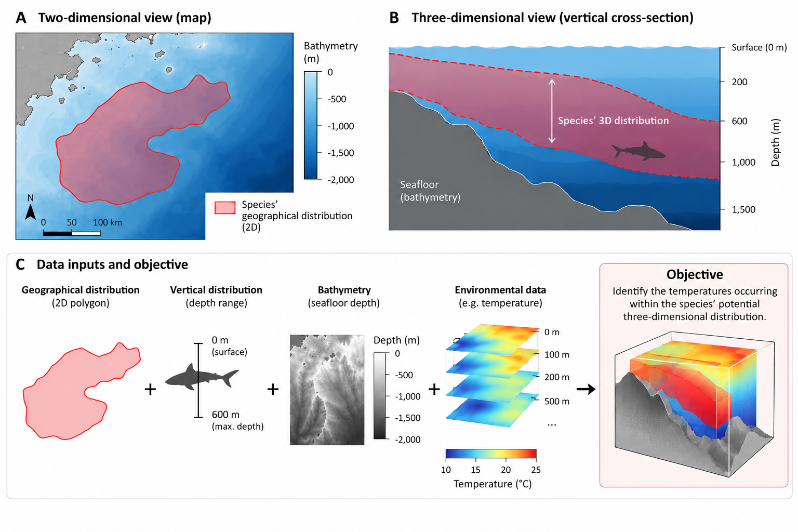
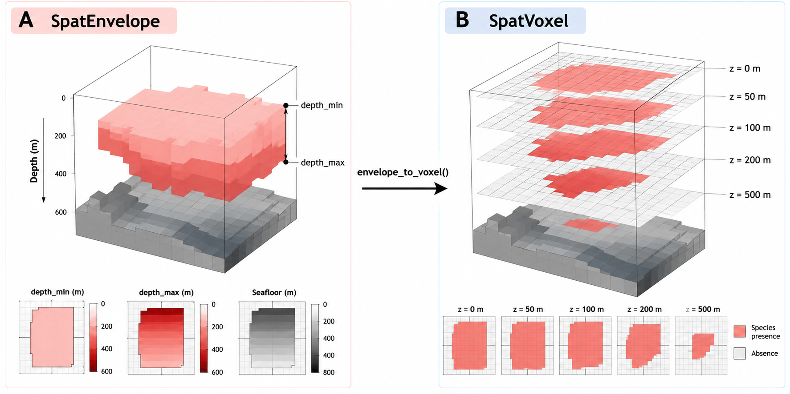

# **Project Spec**

This document describes the design of `ocean3d`, an R package for analysing marine habitats in 3D: how species, human activities and environmental conditions overlap in space and depth. 

The primary operation that `ocean3d` is focused on is the spatial querying of large 3D marine datasets. `ocean3d` enables asking questions like 
1. What range of environmental conditions is a species found in? 
2. How much does a given anthropogenic activity affect a species? 
3. What impact could protective measures have on a species?

while considering three-dimensional space. 



*Figure 1. A species' geographical range (A) and depth range, bounded by bathymetry, give its potential 3D distribution (B). Environmental data are then summarised within that space (C). From the Getting Started vignette.*

Technically, this means that `ocean3d` needs to be able to take points (0D), lines (1D), polygons (2D) and 3D raster stacks and query how these intersect with one another. 

**Key design decisions**

- **Three steps:** an analysis is build → intersect → summarise, and each analysis function belongs to one step ([Package design](#package-design-build-intersect-summarise)). The extraction functions don't follow this yet; they will either become wrappers over the three steps or be retired in favour of workflow vignettes (undecided).
- **Now:** two data models. netCDF files are used for point, buffer and track extraction; `SpatVoxel` / `SpatEnvelope` for everything else ([Data model](#data-model)).
- **Planned (#99):** one model with time as a dimension, reading only the data each step needs: the package's own core object, read with ncdf4 and CFtime, terra for slices in memory, and stars only for remote Zarr (agreed in #112; trial in [`dev/data-model-trial.md`](dev/data-model-trial.md)).
- **Done (#113):** the core object, `SpatProxy`. It records the grid, depths and time steps of a netCDF file, a series of files or a voxel in memory, and reads one time step as a `SpatVoxel`.
- **Done (#114):** one vector class, `SpatVector3D`, holding points, lines and polygons with depth.
- **Done (#111):** CFtime decodes time on the standard calendars.

## Package design: build, intersect, summarise

An analysis in `ocean3d` has three steps, and each analysis function belongs to one of them (downloads and cache utilities sit outside). The output of one step is the input to the next, and each step can be used on its own.

1. **Build:** turn inputs (observations, tracks, polygons with depth ranges, rasters, netCDF data) into 3D objects.
2. **Intersect:** find where 3D objects meet each other or the data: the space they share, whether they share any, or the data values inside a shape.
3. **Summarise:** turn what intersect returns into results: volumes, overlap, and statistics per shape or group.

| Step | Question | Exists now | Planned additions |
|---|---|---|---|
| Build | What is the 3D shape or grid? | `as_voxel()`, `as_envelope()`, `vect_to_envelope()`, `envelope_to_voxel()`, `voxel_to_envelope()`, `occupied()`, `create_study_raster()`, `as_vector3d()`, `buffer_3d()`, `vector3d_to_envelope()`, data loaders (`woa_download()`, `load_gebco_bathymetry()`, `gfw_effort_to_raster()`) | track sampling; picking out features of a `SpatVector3D` (`x[i]`); `crop()` of a `SpatProxy` by a `SpatVector3D`; time matching in `as_voxel()` for a `SpatProxy` (one voxel for one time, or a list of voxels, one per time step, for a time window) |
| Intersect | Where do they meet? | `intersect_3d()`, `intersects_3d()`, `mask()` | the same functions for `SpatVector3D` (polygons with envelopes, voxels and other polygons done; points to come; lines go through `buffer_3d()` or track sampling) |
| Summarise | How much, and what values? | `volume()` (total or per cell; total only for `SpatVector3D` polygons) | `summarise_3d()` for statistics on the values in a voxel, such as one masked to a shape; per-level cell volume (`volume(x, per_cell = TRUE, per_level = TRUE)`) |

The planned functions are added alongside the existing ones: every function in "Exists now" stays, and the existing intersect functions gain methods for `SpatVector3D`. One existing function is removed: `woa_load_nc()`, whose job `as_proxy()` and `as_voxel()` now do for any netCDF file (#157). Voxels store depth in `terra::depth()` rather than in layer names (see [Direction](#direction-a-hybrid)).

The Getting Started vignette follows the three steps: it builds a species' 3D range with `vect_to_envelope()`, keeps the temperatures inside it with `mask()`, and summarises them per depth with `terra::global()`.

Rules:

- The functions for each step are exported, so users can stop after any step, inspect the result, or use their own shapes or statistics.
- Arguments with the same meaning have the same name and default in every step, and input checks are shared (#116).
- New features go into one step, not into a function that combines steps. A new shape (e.g. an ellipsoid buffer) is a builder; a new statistic is an option of the summary function.

**Combined functions.** The extraction functions run the steps together in one call: they turn the input into a shape, find the data cells inside it and compute a statistic. The same work is written separately for points, buffers, tracks and areas, with different arguments for the same idea (#101, #104, #105); `extract_to_buffer()` alone has about 2100 lines and 36 arguments. Once the three steps exist, the work they do moves into the steps, and each function either stays as a short wrapper or is retired:

- **Keep as wrappers:** each function keeps its current arguments and results and calls the three steps. Existing code and teaching material keep working, and a one-line call stays available; the cost is keeping their many arguments in step with the steps' arguments. `extract_to_buffer()`, and the buffer summaries in `extract_to_track()`, can't keep their output this way: the three steps leave out partial-coverage weights, time weighting, `min_valid_fraction` and `most_similar` (see [Extraction on the three steps](#extraction-on-the-three-steps)). Whether `extract_to_buffer()` is retired or kept with a changed output is open (#116).
- **Retire, with workflow vignettes:** the steps become the only way to extract, and vignettes show the build → intersect → summarise code for points, buffers, tracks and areas. The package has one way to do each thing and a smaller set of arguments to document; the cost is that existing code breaks, so the functions need a deprecation period (a warning pointing to the vignette, for at least one release) and NEWS entries.
- Either way, the steps and vignettes come first, so the choice can be made per function once the steps are in use, and before the rOpenSci and CRAN submissions (#12).

Each function maps onto the three steps as follows:

| Function | Build | Intersect | Summarise |
|---|---|---|---|
| `extract_to_point()` | points, one per row; the voxel at each point's time step | `mask()` at each point's cell and depth level | none (the value) |
| `extract_to_buffer()` | points, buffered into polygons (radius × depth window × time window); the voxels for each buffer's time steps | `mask()` per buffer | per row |
| `extract_to_area()` | one polygon × depth band | `mask()` | optional |
| `extract_to_track()` | lines, sampled into points (optionally buffered) | as for points or polygons | per sample, then per track |

How the planned functions work is described in [Extraction on the three steps](#extraction-on-the-three-steps).

## Vector Representations in 3D space
For more background: https://en.wikipedia.org/wiki/Geometric_primitive

`ocean3d` plans one vector class for these, `SpatVector3D`, holding points, lines or polygons. See [Vector class: `SpatVector3D`](#vector-class-spatvector3d).

### 0D (Points / Vertices)
A point has no length, width or height, but has a position in 3D: three coordinates. In 3D graphics these are called vertices. 

In `ocean3d`, a point has a lon (longitude), lat (latitude), depth (metres) and optional time, e.g. a tag detection at 35 m. These will be the points type of `SpatVector3D`.

### 1D (Lines / Edges)
A line connects two or more points; it has length but no width. In 3D graphics these are called edges. 

In `ocean3d`, each vertex of a line has its own depth and time, so a line can follow a dive profile or a vessel route. These will be the lines type of `SpatVector3D`.

`extract_to_track()` already extracts environmental values along lines, such as tagging tracks or fishing vessel routes, by sampling points along each ordered track and extracting at them with `extract_to_point()` (#31). It takes an ordered table of vertices rather than a class.

### 2D (Polygons / Faces)
A polygon is a closed shape made of points connected in order on one plane; it has length and width. In 3D graphics these are called faces. 

`ocean3d` doesn't handle polygons whose vertices each have their own depth. Instead, a polygon has one depth range for the whole shape. For example, an IUCN Red List range is a 2D polygon with a separate depth range. This is often called 2.5D. 

These will be the polygons type of `SpatVector3D`: a polygon with a top and bottom depth and optional time interval, e.g. a marine protected area (MPA) × 0–200 m. Buffering a point or line gives polygons.

### 3D (Volumes)
Volumes are closed geometries that are formed by multiple polygons. 

Polygons in `SpatVector3D` enclose a volume: everything between their top and bottom. Tops and bottoms that vary across the polygon cover spheres, ellipsoids and layers that follow the seafloor. Full 3D volumes, with overhangs or several depth bands in one column, are out of scope. They may be needed later for 3D models from photogrammetry. 

## Raster Representations in 3D space

### 2D (Raster) 

A 2D raster is a grid over the study area with a value in each cell. 

### 3D (Voxel)



*Figure 2. The two raster representations of the same distribution. (A) A `SpatEnvelope` ([min-max 2.5D](#3d-min-max-25d)) stores `depth_min` and `depth_max` per cell, bounded by the seafloor. (B) `envelope_to_voxel()` converts it to a `SpatVoxel`, one layer per standard depth. From the Getting Started vignette.*

A 3D raster is a stack of 2D rasters, one per standard depth, as in Copernicus Marine and World Ocean Atlas (WOA) data. netCDF files store these stacks. In 3D graphics this is called a **voxel model**. 

A `SpatVoxel` stores each layer's depth in `terra::depth()`, terra's own per-layer field (#113). `as_voxel()` also names layers `{variable}_depth={value}` as labels for people to read (e.g. `t_an_depth=0`, `t_an_depth=100` for WOA annual mean temperature, `t_an`, at 0 and 100 m). The package never reads depths from layer names (see [Direction](#direction-a-hybrid)).

The depth range each layer covers depends on the source file. WOA, for instance, gives explicit depth bounds: the 0 m layer covers 0–2.5 m, the 5 m layer 2.5–7.5 m, the 10 m layer 7.5–12.5 m, and so on. 

These rasters hold values across x, y and depth: e.g. temperature in °C, or a species' probability of occurrence, at each coordinate and depth. 

`depths()` reads the depths from `terra::depth()`, e.g. so `extract_to_area()` can select layers in a depth range.

### 3D (Min-max 2.5D)

Called 2.5D in GIS, as in digital elevation models, where each cell holds the land height. 

A species range can be stored as a minimum-depth and a maximum-depth raster (Figure 2A). Maximum depth could be bound by the bathymetry raster, or by the maximum depth the species is found at. 

This needs only two rasters (min and max) rather than one per standard depth. The downside is that a 2.5D envelope can't represent gaps between its min and max depth. 

## Data model

### Now: two models

`ocean3d` currently has two separate data models for the same kind of data (gridded marine variables by longitude, latitude and depth). Functions take one or the other, and no exported function converts one to the other.

"CF" below means the [Climate and Forecast (CF) Conventions](https://cfconventions.org/), the standard for metadata in netCDF files used by Copernicus Marine, WOA and many ocean models. CF attributes say how to read the stored numbers: time units and calendar (`hours since 1950-01-01`, `noleap`), depth units and direction (`positive = "down"`), cell edges (`bounds`), and which dimension is which (`axis`, `standard_name`). "CF-correct" means reading these as the conventions define them.

| | netCDF model | `SpatVoxel` model |
|---|---|---|
| Functions | `extract_to_point()` and its `extract2d()` / `extract3d_*()` wrappers, `extract_to_buffer()`, `extract_to_track()` | `extract_to_area()`, `volume()`, `intersect_3d()`, `intersects_3d()`, `mask()`, voxel profiles, `as_voxel()`, `as_envelope()`, `load_gebco_bathymetry()`, `gfw_effort_to_raster()` |
| Input | netCDF paths, connections or file tables | `SpatVoxel` / `SpatEnvelope`, S4 classes extending `terra::SpatRaster` |
| Reads with | ncdf4, only the cells each observation needs | terra |
| Depth | the netCDF depth coordinate: units converted to metres, `positive` direction, bounds | `terra::depth()`, one set of depths for the whole grid, and each layer's top and bottom (depth edges) when the voxel has them |
| Time | CF time decoding (calendars, sub-daily steps, nearest or exact matching, series split across files) | at most one date per voxel, in `terra::time()`; the voxel tools don't use it |
| Cell edges | CF bounds, or inferred from cell centres | terra's regular grid extent and resolution |

The netCDF model keeps 4D data (lon, lat, depth, time) and its CF metadata intact and reads only the cells it needs. The voxel model gets terra's raster operations (crop, mask, cell area, resampling), which the volume and overlap tools depend on. The cost of the split: a voxel can't be passed to `extract_to_point()`, a netCDF file can't be passed to `extract_to_area()`, depth and grid handling is written twice with different rules, and the voxel tools have no time dimension.

### Planned: one model (#99)

This section is the plan from #99, decided with the stars and ncdfCF trial (#112). The core object (`SpatProxy`, experimental) is implemented: it reads a netCDF file, a series of files or a voxel in memory, and builds a `SpatVoxel` for one time step. Time matching for shapes, the point methods, `summarise_3d()` and volume through time aren't built yet (see [Order of work](#order-of-work), steps 5, 7 and 8).

#### Requirements

1. **Time-aware 3D analysis.** Time is a real dimension of the core object (the single object that will describe gridded data; see [Direction](#direction-a-hybrid)). Volume, overlap and profiles work through time (for example seasonal habitat volume, or overlap by month), not only on a static voxel. Volume through time is planned in #159.
2. **Lazy reads for data larger than memory.** Opening a dataset doesn't read its values, every operation reads only the slices it needs, and heavy processing runs per time step, or per tile within a time step, so peak memory follows the size of one slice or tile rather than the whole dataset.
3. **CF-correct metadata** for the grids in scope: time units on the standard calendars, sub-daily steps, depth units and direction, bounds and longitude conventions. The current code gets this only partly right (13 of the trial's 29 cases): #71–#75 set the behaviour to keep. Of the bugs #88–#96, #88–#93 are fixed, and #95 was closed as not planned (longitude axes with steps over 180° aren't supported). #94 and #96 were closed without a fix; their cases will become tests for time matching in `as_voxel()` (#115).

None of the packages tested (stars, ncdfCF, terra and ncdf4) meets all three on its own (see [the trial](#first-step-stars-and-ncdfcf-trial-112)). **Decision:** ocean3d builds its own core object, reads with ncdf4 and decodes time with CFtime; terra works on slices once they are in memory; stars is used only to read remote Zarr; ncdfCF is not a dependency for now. Agreed by Jay Matsushiba on 2 November 2026 (#112).

#### Direction: a hybrid

- **Core object (`SpatProxy`):** the package's own description of a gridded variable, built with `as_proxy()`. It holds no values.
  - **Name:** in terra, "proxy" means described but not loaded, as in `SpatVectorProxy`. A `SpatVoxel` is one time step of a `SpatProxy` loaded into memory. Named by Jay Matsushiba on 3 November 2026.
  - **Sources:** one netCDF file, a series of files, a remote Zarr store, or a `SpatVoxel` already in memory, so files and voxels are read the same way. Files, series and voxels are implemented (#152); Zarr is planned (#151).
    - **A series** is several files holding the same variable on the same grid and depths, each with time steps that have calendar dates, such as one file per day. The package sorts the files by time and joins their time axes into one, in the first file's units. It stops with an error if time steps repeat or overlap, a file has no time axis, or files are on different grids (spatial tiles). Time bounds are kept only when every file has them.
    - **A voxel in memory** becomes a core object with one time step, keeping the voxel's date (if it has one), cells, depths and depth edges.
  - **Contents:** the variable with its chunk layout (the blocks the file is stored and compressed in), and each axis in a fixed form: longitude and latitude with cell edges, depth in metres positive down with edges and the original storage order, time as a CFtime object with bounds, and the coordinate reference system (CRS). It doesn't store packing (values stored as integers with a scale factor), because ncdf4 unpacks values when it reads, or a longitude convention label, because longitudes can be matched without one (#131).
  - **CF handling happens once, when the core object is built:** axes are recognised from `axis`, `standard_name`, `units` and `positive` on dimension coordinates (#93); longitude axes with steps over 180° aren't supported (#95, closed); explicit bounds are used before inferred edges; depth is converted to metres positive down; time is decoded with CFtime; files in a series are ordered and checked. Later steps only use the result. The time step for a shape is chosen when `as_voxel()` reads it (#115).
  - **Bad cell bounds stop:** every reader that uses cell bounds checks them the same way (positive widths, each cell contains its centre, no overlaps, and for horizontal buffers no overlaps around the globe), and stops with an error that names the file. Point extraction doesn't read time bounds, since it matches observations to time steps. Agreed by Jay Matsushiba on 18 November 2026 (#131), replacing the 3 November 2026 decision in #123 to mark bad time bounds unavailable.
  - **Role:** it turns a request (an area from `crop()`, a time step, a tile) into read windows (which file, and which index ranges to read), and one-time-step `SpatVoxel` views are built from it.
  - **Not a `stars_proxy`:** the layout borrows stars' table of dimensions (values or offset and step, edges, reference system), but stars' proxy operations read far more than they needed, lost metadata when sliced, and couldn't hand real Copernicus data to terra, and stars has no place for the fields above.
- **Reads:** ncdf4 reads every netCDF file with depth or time, including the slices that become voxels, and reads exactly the index windows it is given (see Block reads). terra's own netCDF reading (GDAL's driver) decodes some CF cases wrongly without warning, so it isn't used for these files.
- **Remote Zarr** (#151, not started): an optional source read with `stars::read_mdim()` (Suggests); ncdf4 couldn't open the Copernicus Zarr store with the netCDF-C library used in the trial (Zarr needs a build with NCZarr and S3 support). The package corrects what `read_mdim()` returns: coordinates shifted by half a cell, time as `Date` (or not decoded without a `calendar` attribute), and Copernicus' `elevation` axis (`positive = "up"`) turned into depth.
- **terra:** works only on 2D grids already in memory: cell areas, masks, crop, rasterising polygons and sums, so `volume()`, `intersect_3d()`, `mask()` and `vect_to_envelope()` keep their terra code. It still reads files that have no depth or time, such as GEBCO bathymetry and GFW effort.
- **ncdfCF:** not a dependency for now: its API changed in 4 of its last 8 releases. Its results are a reference for the reader's tests. Revisit at its 1.0 release, or if native model grids come into scope.
- **Grids in scope:** regular lon/lat grids with fixed depth levels, as Copernicus Marine, WOA and OISST distribute them. Native model grids (NEMO-style curvilinear lon/lat, terrain-following sigma or s-coordinate depths as in ROMS) are out of scope for now; such output is regridded before use, and the package rejects it with a clear error (#93). Decided by Jay Matsushiba on 2 November 2026 (#112). If native output becomes an input, revisit ncdfCF, which interpolates curvilinear grids and computes some ocean sigma depths.
- **Time decoding:** [CFtime](https://cran.r-project.org/package=CFtime) replaces the package's own CF time decoder (#111). It decodes CF time units, handles the calendars the CF conventions define (per its documentation; the trial tested `standard`, `proleptic_gregorian`, `noleap` and `360_day`), and matches dates to a time axis quickly. The time axis of the core object is a CFtime object.
  - **Calendars supported for now:** `standard`, `gregorian` and `proleptic_gregorian`, which cover the data in scope (Copernicus Marine, WOA, OISST). Files on other calendars (`noleap` or `365_day`, `all_leap` or `366_day`, `360_day`, `julian`), used mainly by climate model output, stop with a clear error that names the calendar, as they do today. So output columns stay R date-times, and every voxel's time step fits in `terra::time()`.
  - **Adding support later:** the calendar check is in one place, the core object's time axis (#113), so support can be added later without breaking existing code. It needs a way to show dates R can't hold (such as 30 February in `360_day`) in output columns and voxels, and a rule for matching real-world dates to calendars without them. Until then, such files can be converted to a standard calendar with an outside tool (for example CDO). Decided by Jay Matsushiba on 2 November 2026.
  - **Climatologies:** a climatology is a long-term average, such as a WOA annual mean, whose time axis gives a period rather than a date (`months since 0000-01-01`, which CFtime can't decode). One with a single time step is read without a date, so its voxel has no `terra::time()` (#152). Climatologies with more than one step stop with an error for now.
  - **Time runs forwards only:** the core object accepts a time axis only if it is strictly increasing within each file. A time axis that runs backwards (newest first, or ordered by age before present) or is out of order (often files joined in the wrong order) stops with a clear error when the core object is built. The error names the file and points to a separate utility that writes a copy of the file with its time steps in increasing order. Repeated time steps also stop with an error, which the sorting utility can't fix. The core object doesn't reorder time itself, so every later step (matching, bounds, intervals, summaries) can assume forward time, and CFtime never warns about the order. Depth axes are not affected: a reversed depth axis is common and stays supported. The sorting utility is its own exported function and PR, after the core object. Until then, files can be sorted with an outside tool (for example CDO's `sorttimestamp`). The extraction functions keep today's time-order behaviour (a fully reversed axis works with CFtime's warning) until they are rebuilt on the core object or retired (#116). Decided by Jay Matsushiba on 3 November 2026.
- **Heavy spatial work:** per time step, and per tile or group of depth layers when one time step is too large for memory (one day of a global 1/12° product over 50 levels is about 3.5 GB as doubles). Read the slice through the core object, process it with terra, and combine the results across tiles and time; volume and overlap add up across them. For now the voxel builder (below) reads a whole time step at once; reading groups of depth layers is planned with volume through time (#159).
- **`SpatVoxel` / `SpatEnvelope`:** stay terra classes and become views of one time step of the core object, so the existing terra-based tools keep working on a slice.
  - **Builder** (#152): `as_voxel(proxy, time = ...)` reads one time step, chosen by step number or date, and builds the `SpatRaster`:
    - extent from the cell edges, with the CRS always set;
    - grids that are regular apart from rounding in the stored coordinates (centres within 0.1% of a cell of a regular grid) treated as regular, and other irregular grids rejected;
    - depths in `terra::depth()` with the core object's depth edges (none for a single level without bounds), and the step's date in `terra::time()`. For a file without depth bounds, such as Copernicus Marine, the stored edges are the core object's guess: halfway between levels, from the surface to half a gap below the deepest level. So the voxel's `bounds` argument doesn't apply, the bottom layer counts in full, and a depth range or a group of layers measures the same as its share of the whole column, which reading a time step in groups of depth layers (#159) relies on. The same file read with `terra::rast()` and `as_voxel()` has no edges and gets `bounds = "midpoint"` instead, which stops at the deepest level. Decided by Jay Matsushiba on 20 November 2026 (#152).

    Tested on one day (30 July 2026) of Copernicus Marine's global daily temperature product (`cmems_mod_glo_phy-thetao_anfc_0.083deg_P1D-m`, a 0 to 500 m subset): the voxel's depths run 0 to 490.8 m, and its values match those terra reads from the same file, within R's floating-point tolerance. terra reads this file correctly: it has a regular grid, the standard calendar and no depth bounds. It extends `as_voxel()` rather than adding a function; the other constructors and converters (`as_envelope()`, `envelope_to_voxel()`, `voxel_to_envelope()`, `vect_to_envelope()`) don't change. `woa_load_nc()` is removed: a World Ocean Atlas file is read like any other, with `as_proxy(file, var = "t_an")`, and `terra::crop()` of the proxy keeps only the cells of a study area, so `as_voxel()` reads only that window (#157). On `woa23_decav_t04_04.nc` (April temperature at 0.25°) this gives 57 layers with WOA's depth bounds, 0–2.5 m to 1475–1500 m, the CRS EPSG:4326, and values that match `terra::rast()`.
  - **Depth and time:** stored in terra's own per-layer fields, `terra::depth()` (metres, positive down) and `terra::time()` (the time step the voxel shows). The class checks only that the depths are distinct, non-negative and ordered shallow to deep.
    - **What terra keeps:** terra holds the depths with a flag that says they are set. On a whole voxel, `crop()` and `mask()` (with an extent, a raster or a polygon), arithmetic and `ifel()` keep them. Selecting layers of a raster in memory (`[[`, `$`, `subset()`) keeps the values but clears the flag, so the next operation resets every depth to 0; `[[<-`, `c()` and `app()` reset them too (terra 1.9.50). The `SpatVoxel` methods for `subset()`, `[[<-` and `c()` keep the depths, so a voxel keeps them through these operations. `app()` returns a plain `SpatRaster`, which needs `depths` again (#152).
    - **Layer names:** labels only. `as_voxel()` names layers `{variable}_depth={value}` when it sets the depths, and renaming them doesn't change the depths.
    - **Depths must be set:** a raster without `terra::depth()` set is an error in `as_voxel()`, `depths()` and the class checks, which say to pass `depths` or set `terra::depth()`. Whether depths are set is terra's flag, the only way to tell a 0 m layer from a layer without a depth; terra has no exported accessor for it, so the package reads the internal field, and a terra release that renames it makes every raster read as having no depths, which the tests catch.
    - **Depth edges:** the `depth_edges` slot (#138) holds each layer's top and bottom depth, matched to the layer by depth, so it stays correct after selecting layers (`v[[i]]`). This replaces the 2 November plan of "no new S4 slots". Decided by Jay Matsushiba on 19 November 2026.
  - **No depths from layer names:** `terra::depth()` is the only record of a voxel's depths, and layer names are never read as depths, not even on input. A raster whose layers are named `{variable}_depth={value}` but whose depths aren't set (existing code, or a voxel written to GeoTIFF) needs `depths`. `depths()` no longer takes a character vector of names; a per-layer summary is labelled with `depths()` of the voxel. Decided by Jay Matsushiba on 20 November 2026 (#152), replacing the 2 November 2026 decision to read such names once on input.
  - **Saving:** with `saveRDS(terra::wrap(v))` or `terra::writeCDF()`, which keep depth and time. GeoTIFF loses depth, so a voxel read back from it needs `depths`. All three save routes tested lose the class, so a reloaded voxel goes back through `as_voxel()`.
  - **API change:** moving depths to `terra::depth()` is a breaking change, in NEWS (#152).
- **Block reads:** ncdf4 reads one box of index space per call (`ncvar_get()` with `start` and `count`), and compressed netCDF-4 decompresses whole chunks. Today the extraction functions make one call per observation, or per buffer cell and time step. In the three steps, each shape is read on its own, as one cropped window per time step (`crop()` then `as_voxel()`). Block reads for many shapes were dropped with the coverage function on 23 November 2026 (#115). A faster path for many points is deferred to #163.
  - **Shapes across the 180° meridian:** a known limitation for now. `buffer_3d()` splits such a buffer into parts of one feature, whose extent then runs from -180 to 180, so `crop()` reads the whole latitude band around the globe for that shape. Reading one window per part isn't planned yet.
- **Extraction:** `extract_to_point()`, `extract_to_buffer()` and `extract_to_track()` either become wrappers over the three steps that keep their arguments and output, or are retired in favour of workflow vignettes (see [Combined functions](#package-design-build-intersect-summarise) and [Extraction on the three steps](#extraction-on-the-three-steps)). `extract_to_buffer()` and the buffer summaries in `extract_to_track()` can't keep their output as wrappers (see [Combined functions](#package-design-build-intersect-summarise)). Either way, opening and CF handling happen in the core object. Matching a shape to a time step moves into `as_voxel()`, matching a point to a cell and depth level moves into the point methods of `intersect_3d()` and `mask()`, and the statistics move into `summarise_3d()`. The steps accept any source of the core object: a netCDF file or series, a Zarr store, or a `SpatVoxel`. Area extraction becomes `mask()` on a voxel read from the core object, so it works on netCDF files and voxels alike, whether or not `extract_to_area()` is kept.

#### Open questions

- **Nearest depth with missing layers:** `extract_to_point()` skips missing layers when choosing the nearest depth. Whether the point methods of `intersect_3d()` and `mask()` keep this (#115).
- **Zarr layouts:** Copernicus Marine serves each product chunked by time step (for maps) and by location (for time series). How the core object records both and which one each step reads (#151).
- **Combined extraction functions:** keep each as a wrapper over the three steps, or retire it in favour of a workflow vignette (#116; see [Combined functions](#package-design-build-intersect-summarise)). For `extract_to_buffer()`, which can't keep its output as a wrapper, the choice is between retiring it and keeping it with a changed output.
- **ncdfCF:** revisit at its 1.0 release or if native model grids come into scope.

#### First step: stars and ncdfCF trial (#112)

Done. The trial ([`dev/data-model-trial.md`](dev/data-model-trial.md)) compared stars (`read_ncdf()`, `read_mdim()`), ncdfCF, terra and the current ncdf4 code on 29 CF cases (the test fixtures and #88–#96), on a two-year Copernicus Marine daily 4D download (55 GB as doubles), a 60 GB synthetic file and two years of NOAA OISST, and on the Copernicus Marine global daily product as a remote Zarr store. The evidence for the decisions above:

- **Correctness:** stars `read_ncdf()` and ncdfCF each got 25 of the 29 cases right, terra (`terra::rast(file)`) 19, `read_mdim()` 12 and the current code 13. Both readers that decode time with CFtime got every time case right, and CFtime matched 500 dates to a 3,650-day axis in 0.08 s. terra's errors were silent: `360_day` dates moved to the next day, explicit bounds ignored, irregular grids read as index positions. `read_mdim()` shifted coordinates by half a cell.
- **Laziness:** every option opened files without reading values and kept peak memory under 400 MB for points and series on the large files. ncdfCF's `subset()` reads nothing until asked.
- **stars proxies:** `st_extract()` took 198–243 s for 2 points (`read_ncdf()`) or tried to allocate 51–56 GB (`read_mdim()`). `read_ncdf(ncsub = )` kept the full time range after reading one step, slicing a proxy dropped the decoded time, and stars slices of the real Copernicus file couldn't be converted to terra.
- **Reads today:** the package's `extract_to_buffer()` took 76–434 s for one buffer that a single box read handles in 4–7 s.

#### Vector class: `SpatVector3D`

The raster side already has 3D classes built on `terra::SpatRaster`. The vector side gets one class that mirrors `terra::SpatVector`: one object holds features of a single geometry type, points, lines or polygons, reported by `geomtype()`. Each type has the depth and time that make sense for it:

| Type | Depth | Time | Example |
|---|---|---|---|
| points | one per vertex | one per vertex (optional) | a tag detection at 35 m |
| lines | one per vertex | one per vertex (optional) | a dive track, a vessel route |
| polygons | a top and a bottom per feature | an interval per feature (optional) | an MPA × 0–200 m, a 10 km buffer × 0–50 m |

Compared with the raster classes:

| | `SpatVoxel` | `SpatEnvelope` | `SpatVector3D` |
|---|---|---|---|
| Holds | values of a variable | a shape | shapes, one or more features with IDs |
| Horizontal | raster cells | raster cells (non-`NA` = footprint) | points, lines or polygons |
| Depth | one per layer (`terra::depth()`), one set of depths for the grid | `[depth_min, depth_max]` per cell | per vertex (points, lines), or top and bottom (polygons) |
| Time | the time step it shows (`terra::time()`) | the time step it was built from, if any | per vertex (points, lines), or an interval (polygons) |

Rules:

- **Absent is `NA`:** in every raster that holds or measures an object (an envelope, a voxel, `intersect_3d()`, `mask()`, `volume(per_cell = TRUE)`), a cell the object doesn't reach is `NA`, never `0`. `0` is a measurement (e.g. a zero-thickness interval) and `FALSE` an answer to a per-cell question (`intersects_3d()`). A map with `0` where two inputs are present but share nothing is built from the inputs' presence, not returned by an intersect or summarise step.
- **Depth by type:** points and lines have a depth at each vertex; polygons have a top and a bottom. A depth range (e.g. a buffer's depth window) makes it a polygon.
- **Buffering** points or lines gives polygons, as `sf::st_buffer()` does in 2D, with a depth window and time window added.
- **Polygon scope:** one depth interval per horizontal position (each vertical line enters the shape once and leaves once). This covers extruded shapes (cylinders, slabs, an MPA × a depth band), spheres, ellipsoids, cones, and shapes that follow the seafloor or mixed layer. Full 3D volumes (overhangs, several depth bands in one column) are out of scope.
- **Polygon surfaces:** `top` and `bottom` are each a constant (first version); later, a named shape with parameters (e.g. an ellipsoid buffer), a raster (e.g. relative to GEBCO bathymetry), or, as a fallback, a function of position. Every form reduces to "depth interval at these positions", so adding a shape doesn't change extraction code. `top <= bottom` everywhere in the polygon.
- **Volume** is defined for polygons only. `volume()` on points or lines is an error suggesting buffering, as area only makes sense for polygons in 2D.
- **Conversion** of polygons to a `SpatEnvelope` (`vector3d_to_envelope()`) evaluates top and bottom at each cell of a template grid, like `vect_to_envelope()`. Where polygons overlap, a cell gets the shallowest top and the deepest bottom of the polygons covering it, so separate depth bands over one cell merge into one range. Cells with no thickness (top equal to bottom) are dropped. Polygon times are dropped, with a message, because an envelope has no time interval.
- **Storage:** points and lines are stored as a vertex table (lon, lat, depth, time, feature ID, order), the format `extract_to_track()` uses now, and are read from sf (conversion back to sf isn't planned, #124). sf isn't the storage because it treats Z as height and most of its operations drop depth and time. Polygons keep their outlines in an sf geometry column, with one depth range and time interval per polygon (#132).
- `SpatVolume` extends to `c("SpatVoxel", "SpatEnvelope", "SpatVector3D")`; its docs note that only polygons have volume.

#### Extraction on the three steps

The three steps are the package design (see [Package design](#package-design-build-intersect-summarise)). **Decision:** there is no coverage function. Users loop over their shapes one at a time, as a vignette will show. Decided by Jay Matsushiba on 23 November 2026 (#115, #116), replacing the planned `coverage_3d()`, its table of cells and weights, and its block reads. This section plans the parts extraction still needs: picking out one shape, cropping a proxy to a shape, time matching in `as_voxel()`, point methods for the intersect functions, per-level cell volume and `summarise_3d()`. Function names marked "planned" are working names, to be settled in the issue for each step.

*1. Build.* `SpatVector3D` builders create shapes without reading the data they will be compared with.

```r
# points or lines: a depth (and time) at each vertex
detections <- as_vector3d(obs, depth = "depth", time = "datetime")

# polygons: a top and bottom (and time interval) per feature
mpa_band <- as_vector3d(mpa, top = 0, bottom = 200, time = c(t0, t1))

# buffering points or lines gives polygons
buffers <- buffer_3d(detections, radius_km = 10, depth_window = 25, time_window = 1)
```

Names follow the existing converters: `as_<class>()` builds an object of that class (`as_voxel()`, `as_envelope()`, `as_vector3d()`), and `<from>_to_<to>()` converts between classes (`voxel_to_envelope()`, `vector3d_to_envelope()`). `buffer_3d()` uses the `_3d` suffix like `intersect_3d()`.

- A `SpatVector3D` holds one or more features, each with an ID that the later steps keep. One row of an observation table becomes one point; a buffer around it becomes one polygon.
- Sampling a track (vertices, even spacing, one sample per cell) is a build step: it turns lines into points, which can then be buffered. The check that each track segment stays in water belongs here too, so invalid samples are marked before anything is read.
- Converting between classes (`SpatVector3D` polygons to `SpatEnvelope` on a template grid, envelope to voxel) is also a build step.
- *(planned)* `x[i]` picks out features of a `SpatVector3D`, keeping their IDs, so a loop can take one shape at a time.
- Reading the data for a shape is a build step too: `as_voxel(crop(proxy, shape), time = shape)` reads only the cells around the shape. *(planned)* `crop()` of a `SpatProxy` takes an extent or a `SpatRaster` today; taking a `SpatVector3D` needs `ext()` and `crs()` methods for `SpatVector3D`. *(planned)* `time` takes a date-time or a shape, and the time step is chosen by the nearest or exact rule (`time_match`, from `extract_to_point()`), with `max_time_diff` capping how far a nearest match may be. A date-time gives one voxel. A shape always gives a list with one voxel per time step it covers, even if it covers only one; a shape without a time on a source with one time step (such as a WOA climatology) gives a list of one. On a source with several time steps, a shape without a time stops with an error asking for `time`, so a whole series is never read by accident. Decided by Jay Matsushiba on 23 November 2026.

*2. Intersect.* Intersection finds where shapes and data meet. It doesn't read files: the data for a shape were read into a voxel in the build step.

- `intersect_3d()`, `intersects_3d()` and `mask()` keep their current meaning and gain methods for `SpatVector3D`. `intersect_3d()` returns the shared space, which is a shape, not data values: a voxel result holds `1` in each cell and depth level both inputs cover and `NA` elsewhere.
- A shape either covers a cell and depth level or doesn't: there are no partial-coverage weights (the share of a cell's area, depth or time that a shape covers) for now. The rules are the existing ones: a polygon covers every cell it touches, as in `vector3d_to_envelope()` (`terra::rasterize(touches = TRUE)`), and a depth level counts when the shape's depth range overlaps the level's slab, taken from the voxel's depth edges or else from the `bounds` rule (`"midpoint"` or `"top"`).
- *(planned)* A point covers one cell and one depth level: the cell it falls in and the nearest depth level, as `extract_to_point()` does with `method = "nearest"`.
- Lines aren't supported: `buffer_3d()` turns them into polygons, and track sampling turns them into points (#105).
- `mask(v, shape)` keeps the voxel's values in the cells and levels the shape covers. Overlapping shapes masked onto one grid together are merged, so users loop over shapes one at a time to keep each shape's values separate.

*3. Summarise.* *(planned)* `summarise_3d()` summarises the values in a voxel, typically one masked to a shape, or in a list of voxels, one per time step. It doesn't read files or handle geometry, so it can be tested on small synthetic voxels.

```r
results <- lapply(seq_len(length(buffers)), function(i) {
  s   <- buffers[i]
  vs  <- as_voxel(crop(proxy, s), time = s)   # a list: one voxel per time step the buffer covers
  out <- summarise_3d(lapply(vs, mask, s), "mean", by = "time")   # one row per time step
  cbind(feature_id = s@features$feature_id, out)
})
results <- do.call(rbind, results)
```

- Every non-`NA` value counts, across all cells and depth levels.
- Statistics: mean, sd, min, max and median.
- `weighting = "volume"` weights each value by the volume of its cell and depth level (cell area × slab thickness), because cells shrink towards the poles and depth levels range from a few metres to 100 m or more thick. `"equal"` counts each value once. The slabs come from the voxel's depth edges or else the `bounds` rule, and `summarise_3d()` takes the same `bounds` argument as `volume()`. *(planned)* The same weights are available directly from `volume(x, per_cell = TRUE, per_level = TRUE)`, a `SpatVoxel` of km³ per cell and depth level.
- `by = NULL` gives one row. `by = "depth"` gives one row per depth level (a depth profile); over a list of voxels, it gives one row per depth level per time step, not pooled across steps (#159). `by = "time"` gives one row per voxel in a list.
- The result is a data frame with a column per statistic and `n`, the number of values used, so users can drop summaries built on too few values.
- Left out for now: partial weights; time weighting; `most_similar`, the value closest to a target, with its location; and `min_valid_fraction`, the smallest share of a shape that must have data. After `mask()`, cells without data look the same as cells outside the shape, so that share can't be measured from a masked voxel. Summaries across the samples of a track are planned with track sampling (#105).
- `volume()` measures shapes rather than values. Its existing results don't change: *(planned)* the voxel method computes the volume per cell and depth level first, and `per_cell = TRUE` (one total per water column) and the total are sums of it.

#### Order of work

Each step has its own issue, and each PR branches off `main`. Status as of 23 November 2026.

1. **Document the current split:** which functions take netCDF and which take `SpatVoxel` (README function overview and each function's `@param`) (#109). *Done (#118, merged 2 November 2026).* Ran in parallel with step 2.
2. **Trial stars, ncdfCF and terra against the current reader, and agree the core data model** (#112). *Done (#119); the decision was agreed on 2 November 2026 and is recorded in this section.* Run before steps 3 and 4, although the plan from #99 listed it after them, because its result decides what those steps build towards. It also settled the grids in scope, where voxels keep depth and time, and that the extraction functions may be retired.
3. **Move the shared CF/netCDF helpers** for sources, dimension detection, reading, longitude and latitude, depth and bounds out of `R/extract_to_points.R` into `R/netcdf-sources.R`, `R/netcdf-dims.R`, `R/netcdf-read.R`, `R/netcdf-horizontal.R`, `R/netcdf-depth.R` and `R/netcdf-bounds.R`, unchanged (#110). *Done.* They are the starting point for the core object's axis handling in step 5, so they are grouped by axis rather than by the extraction function that uses them. The time helpers stay in `R/extract_to_points.R` for step 4, which replaces them.
4. **Replace the internal CF time decoding with CFtime and fix time matching** (#111), with the time tests from #71–#75 as reference behaviour, fixing #88–#92. The time helpers move out of `R/extract_to_points.R` into `R/netcdf-time.R`. *Done:* the decoder (#88, #90, #92) in #121, then matching (#89, #91 and the midnight case of #71) in #122. Non-standard calendars stay unsupported, with a clear error (see Direction, Time decoding). Must be done before step 5, because the core object's time axis is a CFtime object.
5. **Build the core object** (#113). *Done:* time bounds are decoded with CFtime's bounds support (#123), and the time tests call the shared helpers directly (#127). The first PR (#131) adds the experimental `SpatProxy` class and `as_proxy()`. It describes one variable of one netCDF file without reading values: its chunk sizes, the axes in fixed form, time running forwards only (see Direction, Time decoding) and the CRS. The second PR (#143) adds the internal reader for one read window, which returns the values with the axes in the order lon, lat, depth, time. The third (#152) moves voxel depths to `terra::depth()`, adds the voxel builder (`as_voxel()` on a `SpatProxy`), reads climatologies with one time step, and accepts a series of files or a `SpatVoxel` in memory as sources. The fourth (#157), the last of #113, adds `terra::crop()` for a `SpatProxy`, so that only an area is read, and removes `woa_load_nc()`, whose job `as_proxy()` and `as_voxel()` now do. Split out of #113: volume through time, including reads in groups of depth layers when one time step is too large for memory (#159); remote Zarr (#151); extraction on the core object (#116). After the core object: the utility that writes a time-sorted copy of a file (see Direction, Time decoding).
6. **Add `SpatVector3D`** with `geomtype()`, `as_vector3d()` and sf input: points and lines with per-vertex depth and time, and polygons with constant top and bottom and an optional time interval. Then `buffer_3d()` and `vector3d_to_envelope()` (#114). *Done:* points and lines (#124), polygons (#132), `buffer_3d()` (#144) and `vector3d_to_envelope()` (#145).
7. **Add `intersect_3d()` / `intersects_3d()` / `mask()` / `volume()` methods for `SpatVector3D`, and what the per-shape loop needs** (#115). *In progress:* the first PR (#158, merged 23 November 2026) adds `volume()` for polygons, `intersect_3d()`, `intersects_3d()` and `mask()` between polygons and an envelope or voxel, and `intersect_3d()` and `intersects_3d()` between two sets of polygons. Next: `x[i]` for a `SpatVector3D`, `ext()` and `crs()` for a `SpatVector3D` so that `crop()` of a `SpatProxy` takes one, points in the intersect functions, time matching in `as_voxel()` for a `SpatProxy`, a vignette with the per-shape loop, and `vector3d_to_voxel()` (puts polygons on a voxel's levels without filling depth gaps). The coverage function planned here was dropped on 23 November 2026 (see [Extraction on the three steps](#extraction-on-the-three-steps)).
8. **Add `summarise_3d()` on voxels, per-level cell volume (`volume(per_level = TRUE)`) and workflow vignettes** for points, buffers, tracks and areas. Then, one function per PR, either reimplement each extraction function as a build → intersect → summarise wrapper or deprecate it in favour of its vignette (#116). *Not started.*
9. **Add track sampling** as a build step and buffered tracks (#105); then named shapes, raster and function surfaces for polygons (#117). *Not started.*

The existing tests for both models, including the buffer and track tests, define the expected behaviour. They keep passing for functions kept as wrappers, except where a function's output changes (as `extract_to_buffer()`'s would; see [Combined functions](#package-design-build-intersect-summarise)); for a function that is retired, the same checks move onto the three steps (same inputs, same values) before it is deprecated. New tests check that the same synthetic data gives the same values from a netCDF file, the core object and the matching `SpatVoxel`. API changes (`woa_load_nc()` removed, what the voxel constructors return, depths stored in `terra::depth()` instead of layer names, time in volume and overlap, any retired extraction function) need NEWS entries and should settle before the rOpenSci and CRAN submissions (#12).

## `ocean3d` functionality

Grouped by the step each function belongs to ([Package design](#package-design-build-intersect-summarise)).

### Build: conversions between spatial representations
- **Create a study grid**. A grid for the study area that other data are converted onto (`create_study_raster()`). 
- **Convert 2D polygons with depth data to 2.5D.** Combine a 2D polygon with a depth range, bounded by the seafloor (`vect_to_envelope()`), e.g. IUCN Red List species ranges. 
- **Convert 2D rasters to 2.5D**. Combine a 2D raster with a depth range (`as_envelope()`), e.g. Global Fishing Watch fishing effort by gear type.
- **Convert between 2.5D and 3D rasters**. `envelope_to_voxel()` places an envelope on a set of standard depths; `voxel_to_envelope()` keeps the shallowest and deepest level per cell where a test on the values holds (by default, not `NA`), filling any gaps in between.
- **Build a `SpatVector3D`**. `as_vector3d()` builds points or lines from a table or sf object with a depth (and time) per vertex, or polygons with a top and bottom (and time interval) per feature, without snapping them to a grid, e.g. tag detections at their depths, a dive track, or an MPA × a depth band.
- **Buffer points and lines into polygons**. `buffer_3d()` adds a horizontal radius, depth window and time window, e.g. a 10 km × ±25 m × ±1 day buffer around each tag detection.
- **Convert `SpatVector3D` polygons to 2.5D**. `vector3d_to_envelope(x, template)` evaluates the top and bottom at each cell of a template grid, like `vect_to_envelope()`. This loses the exact edges, the time interval and any depth gap between overlapping polygons, so use it only when the next step needs a grid (e.g. volume overlap with a species envelope).

### Intersect: spatial query
Three functions handle pairs of 3D objects (`SpatEnvelope`, `SpatVoxel`, and `SpatVector3D`, so far polygons only), or a 3D object with a 2D one (a `SpatRaster` footprint, or polygons). A 2D object restricts the shape horizontally and leaves its depths alone.
- **`intersect_3d(x, y)`**: the 3D space the two share. Two envelopes intersect their depth intervals; two voxels keep the levels both occupy; an envelope is placed on a voxel's levels before the two are compared. The result is a shape, not data values.
- **`intersects_3d(x, y)`**: whether they share any 3D space, cell by cell for rasters, with terra's three answers: `TRUE`, `FALSE` (both present but disjoint, or only one present), `NA` (neither present).
- **`mask(x, mask)`**: `terra::mask()` made depth-aware. Keeps `x`'s values where the mask reaches that cell at that depth. A voxel masked by an envelope puts the envelope on the voxel's own levels, so the caller cannot misalign them.

`SpatVector3D` methods (polygons with an envelope, a voxel or other polygons exist; points and lines are *(planned)*):
- **Vector with vector**: `intersect_3d()` intersects the geometries, the depths and the time intervals. Time intervals include both ends, a feature without a time overlaps any time, and features whose times don't overlap don't intersect.
  - Two polygon sets give one polygon per overlapping pair (footprints and depth intervals intersected), numbered, with `feature_id_x` and `feature_id_y` naming the pair.
  - `intersects_3d()` of two polygon sets returns, for each feature of `x`, the IDs of the features of `y` it shares space with, as `sf::st_intersects()` does.
  - *(planned)* Points with polygons give the points inside them. Lines aren't supported: `buffer_3d()` turns them into polygons, and track sampling into points (#105).
- **Vector with envelope or voxel**: polygons are evaluated on the raster's grid (as in `vector3d_to_envelope()`) and compared cell by cell as two envelopes are. Where polygons overlap over a cell, the depth gap between them is filled. `mask(voxel, x)` keeps the voxel values in the cells and levels `x` reaches. *(planned)* `vector3d_to_voxel()` will put polygons on a voxel's levels one level at a time and keep the gap; points will be compared in the cell each one falls in and its nearest depth level.
- **Vector with a data source**: no separate function. *(planned)* `as_voxel(crop(proxy, shape), time = shape)` reads the data around a shape, and `mask()` keeps the values inside it; users loop over shapes (see [Extraction on the three steps](#extraction-on-the-three-steps)).

These functions are the intersect step of the [package design](#package-design-build-intersect-summarise).

`terra::intersect()` is a 2D test, so on a 3D object it is an error pointing to the functions above. The package's methods name the concrete classes (`SpatVoxel`, `SpatEnvelope`). When a generic has both a `SpatRaster` method and a `SpatVolume` method, as terra's generics do, S4 picks the `SpatRaster` one, so a method on the union would be skipped. The union works as a dispatch target only for generics without a `SpatRaster` method.

### Summarise: extraction

The `extract_to_*()` functions below exist now and combine two or three steps; each is to be kept as a wrapper over the steps or retired (#116). Volume extraction uses `mask()` from the intersect step, followed by a summary; see [Package design](#package-design-build-intersect-summarise). Items marked *(planned)* aren't implemented yet.

- **Point extraction**. `extract_to_point()` extracts the nearest value from netCDF files (e.g. environmental data) to an input point based on its longitude, latitude, depth, and, when available, time.
- **Buffer extraction**. `extract_to_buffer()` summarises netCDF values within a geodesic circle × depth window × time window around each observation, with cell coverage, layer thickness and time weighting, or picks the value closest to a target. The three steps don't reproduce these weights or `most_similar` for now, so `extract_to_buffer()` can't become a wrapper with the same output (#116).
- **Track extraction**. `extract_to_track()` samples points along ordered tracks (e.g. tagging data), extracts netCDF values at them, and can summarise per track.
- **Area extraction**. `extract_to_area()` crops a `SpatVoxel` (e.g. environmental data) to an input polygon and depth band. 
- **Volume extraction**. `mask(voxel, shape)` keeps a `SpatVoxel`'s values (e.g. environmental data) inside a 3D volume and sets the rest to `NA`. The volume is a `SpatEnvelope` (2.5D, e.g. a species range from `vect_to_envelope()` bounded by the seafloor) or a presence `SpatVoxel` (3D). With an envelope, `bounds` sets whether a depth level counts when the envelope reaches its top or its midpoint. The Getting Started vignette uses this to get temperatures within a species' 3D range.
- **Extraction at a `SpatVector3D`** *(planned)*. For each shape, `as_voxel(crop(proxy, shape), time = shape)` reads its time steps, `mask()` keeps the values in the cells and levels it covers, and `summarise_3d()` turns them into statistics. Observations are points, buffers and areas are polygons, and tracks are sampled into points, so this one path replaces the separate code in each function above.

### Summarise: volume calculations
- **Calculate the volume occupied by 2.5D representation**. Each rasterized range stores presence plus `depth_min/depth_max` per cell, clamped to the seafloor. Volume is the sum of `cell_area × (depth_max - depth_min)` over present cells. The overlap between two shapes is the volume of `intersect_3d()`'s result, measured the same way.
- **Calculate the volume occupied by 3D representation**. Each layer's height is the depth range it covers: from the voxel's depth edges when it has them, otherwise halfway to the neighbouring levels but not past the top and bottom levels (`bounds = "midpoint"`, the default since #148). With levels at 0, 100 and 200 m, the 100 m layer is 100 m tall (50 to 150 m) and the 0 and 200 m layers 50 m each.
- **Calculate the volume of `SpatVector3D` polygons**. Measured from the geometry, not a grid: polygon area on the WGS84 ellipsoid × (`bottom` - `top`) for constant surfaces. The time interval doesn't change the volume. The total is the sum over polygons, so space where polygons overlap is counted once for each polygon. `per_cell = TRUE` is an error for polygons, which have no cells: put them on a grid with `vector3d_to_envelope()` first. Points and lines have no volume, so `volume()` on them is an error suggesting `buffer_3d()`. Overlap is measured on `intersect_3d()`'s result, as for envelopes. *(planned)* Exact formulas for named shapes (sphere, ellipsoid) and sampling across the polygon for raster or function surfaces.

### Utilities 
- **Download and prepare data.** Utilities for public data: WOA, GEBCO bathymetry, IUCN Red List and Global Fishing Watch. Copernicus Marine utilities were removed in #53 and are planned to return with a shared cache (#55). 
- **Cached downloads.** WOA files are cached in one place (`woa_cache_dir()`) that all projects read from, so code can be shared without the data. File names give the WOA edition and decade, but the package doesn't yet record which files an analysis used. 
- **The cache records what was downloaded** *(planned, #55)*. For every source, each cached file has a record of the dataset and its version (e.g. WOA23, GEBCO 2025, the Copernicus Marine product and dataset version), the URL it came from, the download date and a checksum. An analysis can then list the exact data it used, and the same versions can be downloaded again elsewhere. 

## Conventions
- **Depth sign convention.** Depths are positive metres increasing downward, but GEBCO bathymetry is negative below sea level. The voxel constructor flips it and clamps land to 0. Document which convention any new argument uses.
- **`ncdf4` vs `terra`**. Point, buffer and track extraction read netCDF directly with `ncdf4`, reading only the cells each observation needs. Large raster operations (1000s of cells), like extracting areas and volumes, use `terra`. This split is planned to become one model; see [Data model](#data-model). Until then, say in each function's docs which input it takes.
- **Time.** Times are decoded from CF units on the standard calendars and matched to observations in UTC. Decoding uses CFtime (#111). Only the netCDF model has a time dimension for now; see [Data model](#data-model).

## Future directions

Ideas not yet started are tracked as GitHub issues. 3D species distribution modelling, once planned here (#108), is being developed in a separate package, [pathlyXYZ](https://github.com/jmenblaz/pathlyXYZ).
