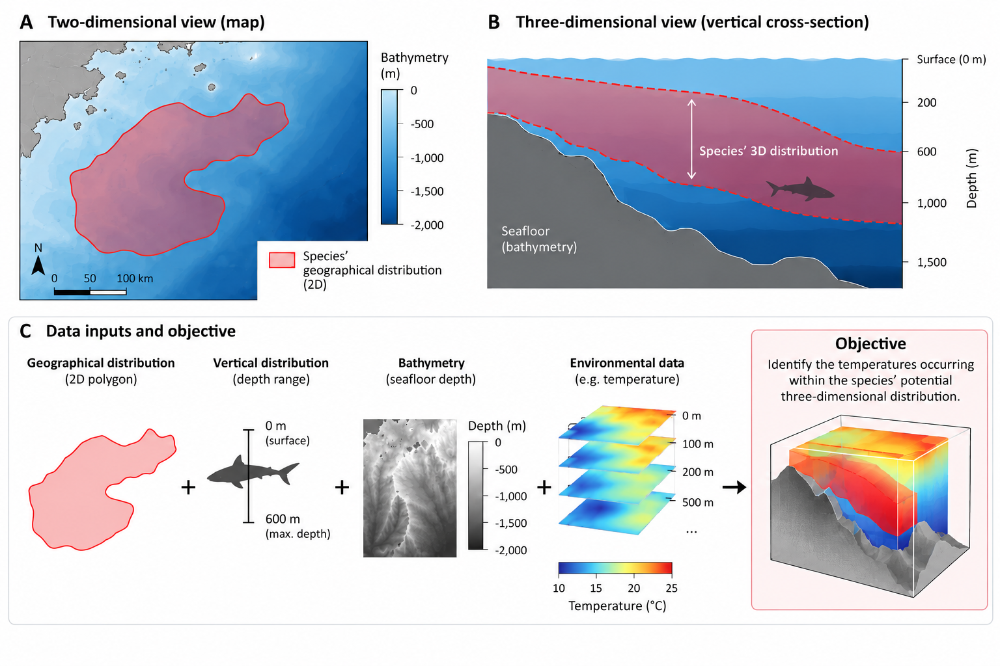
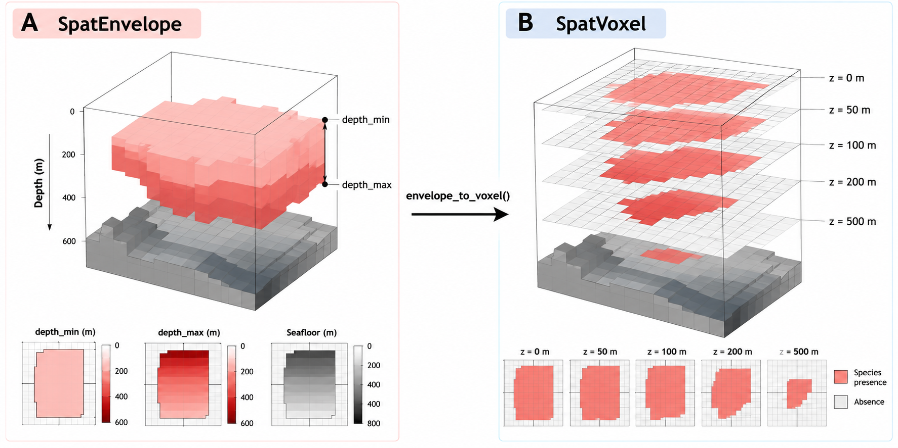

# **Project Spec**

This document describes the overall design decisions for the `ocean3d` project. `ocean3d` is an R package that is designed to facilitate the analysis of marine habitats in 3D, enabling descriptions of interaction between different marine entities, including species, anthropogenic activities, and environmental variables. `ocean3d` is intended to empower users to conduct analyses in the 3D marine environment within the R ecosystem. 

The primary operation that `ocean3d` is focused on is the spatial querying of large 3D marine datasets. `ocean3d` enables asking questions like 
1. What range of environmental conditions is a species found in? 
2. How much does a given anthropogenic activity affect a species? 
3. What impact could protective measures have on a species?

while considering three-dimensional space. 



*Figure 1. A species' geographical range (A) and depth range, bounded by bathymetry, give its potential 3D distribution (B). Environmental data are then summarised within that space (C). From the Getting Started vignette.*

Technically, this means that `ocean3d` needs to be able to take 1D (points), 2D (polygons), and 3D (raster stack) and query how these intersect with one another. 

## Vector Representations in 3D space
For more background: https://en.wikipedia.org/wiki/Geometric_primitive

`ocean3d` plans one vector class for these, `SpatVector3D`, which mirrors `terra::SpatVector`: one class holding points, lines or polygons. See [Vector class: `SpatVector3D`](#vector-class-spatvector3d).
### 0D (Points / Vertices)
These are 0-dimensional, without length, width, or height dimensions. Points can be located in 3-dimensional space though, with 3 coordinate values. They are called vertices in the 3D graphics / modelling field. 

For `ocean3d`, these will be lon (longitude), lat (latitude), and depth (metres), plus a time when one is known. Ex. a tag detection at 35 m. These are the points type of `SpatVector3D`.

### 1D (Lines / Edges)
Lines are two points connected, having a length but no width, therefore considered to be 1-dimensional. These are called edges in the 3D graphics / modelling field. 

In `ocean3d`, each vertex of a line has its own depth and time, so a line can follow a dive profile or a vessel route through time. These are the lines type of `SpatVector3D`.

`extract_to_track()` already extracts environmental values along lines, such as tagging tracks or fishing vessel routes, by sampling points along each ordered track and extracting at them with `extract_to_point()` (#31). It takes an ordered table of vertices rather than a class.

### 2D (Polygons / Faces)
Polygons are constructed from points that exist on the same 2D plane, that are connected in order that creates a closed shape. With length and width, these are 2-dimensional shapes. In 3D graphics / modelling field, they are called faces. 

Currently, `ocean3d` doesn't handle faces that are natively 3D. These are cases where each point that is part of the polygon has a meaningful depth coordinate. Instead, we work with polygons that have depth values associated with the entire polygon. I.e. the polygon is represented on planes that aligned with depth levels. For example, IUCN Red List species ranges that have a species range represented as a 2D polygon with no depths, with separate depth range values provided. This is often called 2.5D representation. 

These are the polygons type of `SpatVector3D`: a 2D polygon with a top and a bottom depth, and optionally a time interval. Ex. an MPA × 0–200 m, or a 10 km buffer around an observation × 0–50 m. Buffering a point or line gives polygons, as in 2D GIS.

### 3D (Volumes)
Volumes are closed geometries that are formed by multiple polygons. 

Polygons in `SpatVector3D` already enclose a volume: everything between the top and bottom over the polygon. With top and bottom surfaces that vary across the polygon, they cover shapes like spheres, ellipsoids and layers that follow the seafloor (see [Vector class: `SpatVector3D`](#vector-class-spatvector3d)). Full 3D volumes, with overhangs or several depth bands in one column, are out of scope. These might become useful if we input 3D models derived from techniques like photogrammetry. 

## Raster Representations in 3D space

### 2D (Raster) 

2D rasters are cellular representations with x, y dimensions. I.e. the whole study space is represented as a grid that has values in every cell. 

### 3D (Voxel)



*Figure 2. The two raster representations of the same distribution. (A) A `SpatEnvelope` ([min-max 2.5D](#3d-min-max-25d)) stores `depth_min` and `depth_max` per cell, bounded by the seafloor. (B) `envelope_to_voxel()` converts it to a `SpatVoxel`, one layer per standard depth. From the Getting Started vignette.*

To extend rasters into 3D, we simply create multiple rasters for a set of standard depths. This is the convention from oceanography datasets, like Copernicus Marine and World Ocean Atlas (WOA). This raster stack is supported with netCDF file type and with the `terra` and `ncdf4` packages. This raster stack is called a **voxel model** in 3D graphics / modelling field. 

Multi-depth rasters used by `ocean3d` must encode depth in layer names using the format `{variable}_{field}_depth={value}` (e.g., `t_an_depth=0`, `t_an_depth=100` for temperature with annual means at 0 and 100 m depths). 

The convention for the depth bounds that a given raster layer represents depends on source netCDF. For example, WOA provides standard depth levels and explicit depth_bnds. For example, the 0 m layer has bounds from 0 to 2.5 m, the 5 m layer 2.5–7.5 m, the 10 m layer 7.5–12.5 m, etc. 

In these rasters, there is a continuous representation of values across x, y, and depth dimensions. For environmental variables, this could be temperature in degrees C at each coordinate and depth. For a species range, this could be probability of occurrence at each coordinate an depth. 

Data source utilities are responsible for converting other formats into this convention. Layer names are parsed by `depths()`, which utilities such as `extract_to_area()` use to determine which depth layers to select for a given depth range.

### 3D (Min-max 2.5D)

Colloquially referred to as the 2.5D model, this is often used for terrain models in GIS. Think like Digital Elevation Models, where the raster values correspond with the height of the landscape. 

We can represent spaces, like species ranges, by describing the space that they occupy with a minimum depth and maximum depth raster (Figure 2A). Maximum depth could be bound by the bathymetry raster, or by the maximum depth the species is found at. 

This representation is more efficient than the 3D Voxel representation, since it only needs two rasters for min and max respectively, compared to needing a raster for every standard depth. The downside is that the 2.5 representation doesn't model situations where there may not be presences between the min and max depths. 

## Data model

### Now: two models

`ocean3d` currently has two separate data models for the same kind of data (gridded marine variables by longitude, latitude and depth). Functions take one or the other, and there is no bridge between them.

"CF" below means the [Climate and Forecast (CF) Conventions](https://cfconventions.org/), the standard for metadata in netCDF files used by Copernicus Marine, WOA and most ocean model output. CF attributes say how to read the stored numbers: time units and calendar (`hours since 1950-01-01`, `noleap`), depth units and direction (`positive = "down"`), cell edges (`bounds`), and which dimension is which (`axis`, `standard_name`). "CF-correct" means reading these as the conventions define them.

| | netCDF model | `SpatVoxel` model |
|---|---|---|
| Functions | `extract_to_point()` and its `extract2d()` / `extract3d_*()` wrappers, `extract_to_buffer()`, `extract_to_track()` | `extract_to_area()`, `volume()`, `calc_volume_overlap()`, `intersect_3d()`, `intersects_3d()`, `mask()`, voxel profiles, `as_voxel()`, `as_envelope()`, `woa_load_nc()`, `load_gebco_bathymetry()`, `gfw_effort_to_raster()` |
| Input | netCDF paths, connections or file tables | `SpatVoxel` / `SpatEnvelope`, S4 classes extending `terra::SpatRaster` |
| Reads with | ncdf4, only the cells each observation needs | terra |
| Depth | the netCDF depth coordinate: units converted to metres, `positive` direction, bounds | layer names (`{variable}_depth={value}`), one set of depths for the whole grid |
| Time | CF time decoding (calendars, sub-daily steps, nearest or exact matching, series split across files) | none |
| Cell edges | CF bounds, or inferred from cell centres | terra's regular grid extent and resolution |

The netCDF model keeps 4D data (lon, lat, depth, time) and its CF metadata intact and reads only the cells it needs. The voxel model gets terra's raster operations (crop, mask, cell area, resampling), which the volume and overlap tools depend on. The cost of the split: a voxel from `woa_load_nc()` can't be passed to `extract_to_point()`, a netCDF file can't be passed to `extract_to_area()`, depth and grid handling is written twice with different rules, and the voxel tools have no time dimension.

### Planned: one model (#99)

This section is the plan from #99. None of it is implemented yet, and the first step (the stars trial below) may change it.

#### Requirements

1. **Time-aware 3D analysis.** Time is a real dimension of the core object. Volume, overlap and profiles work through time (for example seasonal habitat volume, or overlap by month), not only on a static voxel.
2. **Lazy reads for data larger than memory.** Opening a dataset doesn't read its values, every operation reads only the slices it needs, and heavy processing runs per time step or per chunk, so peak memory follows the size of one slice rather than the whole dataset.
3. **CF-correct metadata.** Keep the current handling of time units and calendars, sub-daily steps, depth units and direction, bounds and longitude conventions (#71–#75, #88–#96).

No single package meets all three. terra stores depth and time as layer labels on a stack of 2D layers. stars has real dimensions and lazy `stars_proxy` objects, but only some operations stay lazy. ncdf4 reads exactly what is asked for but leaves everything above reading to the package.

#### Direction: a hybrid

- **Core object:** one object that describes the dimensions (lon/lat with bounds, depth, time, CRS) without loading values, in the style of stars. It may be a `stars_proxy` itself if the trial supports that.
- **Reads:** lazy and exact, through stars proxies, or through the package's own ncdf4 `start` / `count` code where stars falls short. Remote Zarr stores (for example Copernicus Marine ARCO data) would be read through GDAL's multidimensional API (`stars::read_mdim()`).
- **Heavy spatial work:** per time step or per chunk. Read one slice, process it with terra, and combine the results across time.
- **`SpatVoxel` / `SpatEnvelope`:** become views of one time step of the core object, so the existing terra-based tools keep working on a slice.
- **Extraction:** point, buffer and track extraction keep reading only the cells they touch, and accept anything that can become the core object: a netCDF file, a `SpatVoxel`, or a Zarr store.

#### First step: stars trial

Before any code moves, compare stars with the current ncdf4 code:

1. On the synthetic netCDF fixtures from the tests and the #88–#96 cases: do decoded time, depth, bounds and values match the package's results?
2. On a large real file (for example a multi-year daily global Copernicus Marine product), measure peak memory and run time for opening as a proxy, point extraction across time, volume and overlap for one time step, and a polygon or buffer summary over a time window.
3. Optionally, the same dataset as a remote Zarr store.

The result decides whether stars proxies become the core object, or only describe dimensions while the package keeps its own lazy reads.

#### Vector class: `SpatVector3D`

The raster side already has 3D classes built on `terra::SpatRaster`. The vector side gets one class that mirrors `terra::SpatVector`: one object holds features of a single geometry type, points, lines or polygons, reported by `geomtype()`. Each type has the depth and time that make sense for it:

| Type | Depth | Time | Example |
|---|---|---|---|
| points | one per vertex | one per vertex (optional) | a tag detection at 35 m |
| lines | one per vertex | one per vertex (optional) | a dive track, a vessel route |
| polygons | a top and a bottom per feature | an interval per feature (optional) | an MPA × 0–200 m, a 10 km buffer × 0–50 m |

Compared with the raster classes:

| | `SpatVoxel` | `SpatEnvelope` | `SpatVector3D` (planned) |
|---|---|---|---|
| Holds | values of a variable | a shape | shapes, one or more features with IDs |
| Horizontal | raster cells | raster cells (non-`NA` = footprint) | points, lines or polygons |
| Depth | layer index, one set of depths for the grid | `[depth_min, depth_max]` per cell | per vertex (points, lines), or top and bottom (polygons) |
| Time | none | none | per vertex (points, lines), or an interval (polygons) |

Rules:

- **One rule for users:** points and lines have a depth at each vertex; polygons have a top and a bottom. A depth range (e.g. a buffer's depth window) belongs to a polygon.
- **Buffering** points or lines gives polygons, as `sf::st_buffer()` does in 2D, with a depth window and time window added.
- **Polygon scope:** one depth interval per horizontal position (each vertical line enters the shape once and leaves once). This covers extruded shapes (cylinders, slabs, an MPA × a depth band), spheres, ellipsoids, cones, and shapes that follow the seafloor or mixed layer. Full 3D solids (overhangs, several depth bands in one column) are out of scope.
- **Polygon surfaces:** `top` and `bottom` are each a constant (first version), a named shape with parameters (e.g. an ellipsoid buffer), a raster (e.g. relative to GEBCO bathymetry), or, as a fallback, a function of position. Every form reduces to "depth interval at these positions", so adding a shape doesn't change extraction code. `top <= bottom` everywhere in the polygon.
- **Volume** is defined for polygons only. `volume()` on points or lines is an error suggesting buffering, as area only makes sense for polygons in 2D.
- **Conversion** of polygons to a `SpatEnvelope` (`vector3d_to_envelope()`) evaluates top and bottom at each cell of a template grid, like `vect_to_envelope()`.
- **Storage:** points and lines are stored as a table of vertices (`lon`, `lat`, `depth`, `time`, feature ID, vertex order) with a CRS, which is what `extract_to_track()` takes now. Conversion to and from sf `POINT ZM` / `LINESTRING ZM` is supported, but sf isn't the storage: its Z is elevation (positive up), and most sf/GEOS operations drop Z and M. terra's `SpatVector` doesn't keep a depth per vertex either. How polygons store the footprint, and whether the class extends a terra or sf object, depends on the core object chosen by the trial.
- **Inside the package**, polygons are stored differently from points and lines, so some methods branch on `geomtype()`, as terra's do. If the branches grow, `SpatVector3D` can gain subclasses per type without changing code written against it.
- `SpatVolume` extends to `c("SpatVoxel", "SpatEnvelope", "SpatVector3D")`; its docs note that only polygons have volume.

#### Extraction in three steps: build, intersect, summarise

Today each `extract_to_*()` function does everything in one call: it turns its input into a shape, finds the source cells inside that shape, and computes a statistic. `extract_to_buffer()` alone has about 2100 lines and 36 arguments for this. The same three jobs are written separately for points, buffers, tracks and areas, with different arguments for the same idea (#101, #104, #105). The plan splits them into three sets of functions, each usable on its own, where the output of one step is the input to the next:

| Step | Input | Output | Exists now | Planned |
|---|---|---|---|---|
| 1. Build | observations, polygons, lines, rasters, depth and time ranges | 3D shapes: `SpatVector3D`, `SpatEnvelope`, `SpatVoxel` | `as_voxel()`, `as_envelope()`, `vect_to_envelope()`, `voxel_to_envelope()`, `envelope_to_voxel()`, `create_study_raster()` | `as_vector3d()`, `buffer_3d()`, `vector3d_to_envelope()`, track sampling (below) |
| 2. Intersect | two 3D objects, or a source and a shape | the shared space, or the source cells inside a shape with their weights | `intersect_3d()`, `intersects_3d()`, `mask()` for `SpatVoxel` / `SpatEnvelope` | the same verbs for `SpatVector3D` and the core object; a coverage verb (below) |
| 3. Summarise | a coverage table | one row of statistics per shape or group | inside `extract_to_buffer()` and `extract_to_track()` only | `summarise_3d()` (below) |

Function names marked "planned" are working names, to be settled in the issue for each step.

*1. Build.* Builders create shapes and never read source values.

```r
# points or lines: a depth (and time) at each vertex
detections <- as_vector3d(obs, depth = "depth", time = "datetime")

# polygons: a top and bottom (and time interval) per feature
mpa_band <- as_vector3d(mpa, top = 0, bottom = 200, time = c(t0, t1))

# buffering points or lines gives polygons
buffers <- buffer_3d(detections, radius_km = 10, depth_window = 25, time_window = 1)
```

Names follow the existing converters: `as_<class>()` builds an object of that class (`as_voxel()`, `as_envelope()`, `as_vector3d()`), and `<from>_to_<to>()` converts between classes (`voxel_to_envelope()`, `vector3d_to_envelope()`). `buffer_3d()` follows `intersect_3d()`.

- A `SpatVector3D` holds one or more features, each with an ID that the later steps keep. One row of an observation table becomes one point; a buffer around it becomes one polygon.
- Sampling a track (vertices, even spacing, one sample per cell) is a build step: it turns lines into points, which can then be buffered. The marine-mask check on track connections belongs here too, so invalid samples are marked before anything is read.
- Converting between classes (`SpatVector3D` polygons to `SpatEnvelope` on a template grid, envelope to voxel) is also a build step.

*2. Intersect.* Intersection finds where shapes and data meet. It is the only step that reads source values, and it reads only the cells, depths and time steps the shapes touch.

- Shape with shape: `intersect_3d()`, `intersects_3d()` and `mask()` keep their current meaning and gain methods for `SpatVector3D`. The result is a domain, never field values.
- Source with shape: a new verb (working name `coverage_3d(source, shapes)`) returns a coverage table: one row per feature and source cell, with the cell's value, its depth and time step, and its weight. The weight depends on the geometry type:
  - polygons: the polygon's volume inside the cell (covered area × depth overlap) times the time overlap;
  - lines: the length of line inside the cell, or the time spent in it;
  - points: one cell per point with weight 1, picked by the existing nearest or exact matching rules for depth and time (`method`, `time_match`). Those rules move here from `extract_to_point()`.
- Picking the source file for each shape (multi-file series, tiles) and the CF handling of time, depth and bounds live in this step, on the core object.
- Collections are read in blocks, so each block of the source is read once rather than once per shape.

*3. Summarise.* Summaries work on the coverage table only. They don't read files or handle geometry, so they can be tested on small hand-written tables.

```r
coverage <- coverage_3d(source, shapes)
summarise_3d(coverage, statistic = c("mean", "sd"), weighting = "weighted",
             min_valid_fraction = 0.8, by = "id")
```

- One set of statistic names for every shape type: mean, sd, min, max, median, and `most_similar` with a target column. One `weighting` argument: `"weighted"` uses the coverage weights, `"equal"` ignores them.
- `by` sets the grouping: per feature (one buffer), or across features (all samples along a track, weighted by distance or duration). This replaces the separate per-buffer and per-track summaries in the removed `extract_to_buffered_track()` (#105).
- `volume()` and `calc_volume_overlap()` measure shapes rather than values, so they stay as they are; on a coverage table, volume is the sum of the weights.

*Wrappers.* `extract_to_point()`, `extract_to_buffer()`, `extract_to_area()` and `extract_to_track()` keep their current arguments and results and become build → intersect → summarise, plus joining the results back to the input table and printing reports:

| Function | Build | Intersect | Summarise |
|---|---|---|---|
| `extract_to_point()` | points, one per row | one cell per point | none (the value) |
| `extract_to_buffer()` | points, buffered into polygons (radius × depth window × time window) | cells and weights per polygon | per row |
| `extract_to_area()` | one polygon × depth band | `mask()` or coverage | optional |
| `extract_to_track()` | lines, sampled into points (optionally buffered) | as for points or polygons | per sample, then per track |

Rules for the split:

- Each step is exported, so users can stop after any step, inspect the result, or swap in their own shapes or statistics.
- Arguments with the same meaning have the same name and default in every step and wrapper (#101). Input checks are shared (#104).
- New extraction features go into one of the three steps, not into a wrapper. A new shape (e.g. an ellipsoid buffer) is a builder; a new statistic is an option of `summarise_3d()`.

#### Order of work

Each step is its own issue and PR off `main`:

1. Document the current split: which functions take netCDF and which take `SpatVoxel` (README function overview and each function's `@param`).
2. Move the shared CF/netCDF helpers (time decoding, depth axis, bounds, dimension detection) out of `R/extract_to_points.R` into their own files.
3. Run the stars trial and write up the results with a recommendation for the core object.
4. Agree on the core data model and update this section.
5. Build the core object and lazy reader, then time-aware volume, overlap and profiles, then `SpatVoxel` as a time-step view.
6. Add `SpatVector3D` with `geomtype()`, `as_vector3d()` and sf conversion: points and lines with per-vertex depth and time, and polygons with constant top and bottom and an optional time interval. Then `buffer_3d()` and `vector3d_to_envelope()`.
7. Add the coverage verb and `intersect_3d()` / `intersects_3d()` / `mask()` / `volume()` methods for `SpatVector3D`.
8. Add `summarise_3d()`, then reimplement the extraction functions as build → intersect → summarise wrappers, one function per PR.
9. Add track sampling as a build step, buffered tracks (#105), and block-wise reads for many features; then named shapes, raster and function surfaces for polygons.

The existing tests for both models, including the buffer and track tests, are the reference behaviour: they keep passing, and new tests check that the same synthetic data gives the same values from a netCDF file, from the core object and from the equivalent `SpatVoxel`. API changes (what `woa_load_nc()` and the voxel constructors return, time in volume and overlap) need NEWS entries and should settle before the rOpenSci and CRAN submissions (#12).

## `ocean3d` functionality

### Spatial extractions 

The extraction functions below exist now. Each is planned to become a wrapper over build, intersect and summarise steps on a `SpatVector3D`; see [Data model](#data-model). Items marked *(planned)* aren't implemented yet.

- **Point extraction**. `extract_to_point()` extracts the nearest value from netCDF files (ex. environmental data) to an input point based on its longitude, latitude, depth, and, when available, time.
- **Buffer extraction**. `extract_to_buffer()` summarises netCDF values within a geodesic circle × depth window × time window around each observation, with cell coverage, layer thickness and time weighting, or picks the value closest to a target.
- **Track extraction**. `extract_to_track()` samples points along ordered tracks (ex. tagging data), extracts netCDF values at them, and can summarise per track.
- **Area extraction**. `extract_to_area()` crops a `SpatVoxel` (ex. environmental data) to an input polygon and depth band. 
- **Volume extraction**. Extract values from multi-depth raster / voxel model (ex. environmental data) within a three-dimensional spatial volume defined by horizontal extent and depth range. 
  - This should be possible for both 2.5D (two-raster stack) and 3D (multi-depth raster stack). 
- **Extraction at a `SpatVector3D`** *(planned)*. The coverage verb (working name `coverage_3d()`) returns the source cells each feature touches with their weights (one cell per point, length or time along lines, volume × time overlap in polygons), and `summarise_3d()` turns them into statistics. Observations are points, tracks are lines, and buffers and areas are polygons, so this one path replaces the separate code in each function above.

### Conversions between spatial representations
- **Create template voxel grid for study space**. Create the 3D voxel grid for the study space, that can be used as a template to convert other spatial representations to be compatible with it (`create_study_raster()`). 
- **Convert 2D polygons with depth data to 2.5D.** When separate depth ranges are available, use that to convert 2D polygons into 2.5D representations that are bound by bathymetry and depth ranges (`vect_to_envelope()`). Ex. IUCN Red List species ranges. 
- **Convert 2D rasters to 2.5D**. When depth ranges are available, use that to convert 2D raster data into 2.5D representations (`as_envelope()`). Ex. working with Global Fishing Watch data on fishing effort by gear type.
- **Convert between 2.5D and 3D rasters**. `envelope_to_voxel()` places an envelope on a set of standard depths; `voxel_to_envelope()` keeps the shallowest and deepest level per cell where a test on the values holds (by default, not `NA`), filling any gaps in between.
- **Build a `SpatVector3D`** *(planned)*. `as_vector3d()` builds points or lines from a table or sf object with a depth (and time) per vertex, or polygons with a top and bottom (and time interval) per feature, without snapping them to a grid. Ex. tag detections at their depths, a dive track, or an MPA × a depth band.
- **Buffer points and lines into polygons** *(planned)*. `buffer_3d()` adds a horizontal radius, depth window and time window. Ex. a 10 km × ±25 m × ±1 day buffer around each tag detection.
- **Convert `SpatVector3D` polygons to 2.5D** *(planned)*. `vector3d_to_envelope(x, template)` evaluates the top and bottom at each cell of a template grid, like `vect_to_envelope()`. This loses the exact edges and the time interval, so use it only when the next step needs a grid (ex. volume overlap with a species envelope).

### Spatial query
Three verbs cover every pairing of a 3D object (`SpatEnvelope`, `SpatVoxel`, and *(planned)* `SpatVector3D`) with another 3D object or with a 2D one (a `SpatRaster` footprint, or polygons). A 2D object restricts the domain horizontally and leaves its depths alone.
- **`intersect_3d(x, y)`**: the 3D space the two share. Two envelopes intersect their depth intervals; two voxels keep the levels both occupy; an envelope is placed on a voxel's levels before the two are compared. The result is a domain, never field values.
- **`intersects_3d(x, y)`**: whether they share any 3D space, cell by cell, with terra's three answers: `TRUE`, `FALSE` (both present but disjoint, or only one present), `NA` (neither present).
- **`mask(x, mask)`**: `terra::mask()` made depth-aware. Keeps `x`'s values where the mask domain reaches that cell at that depth. A voxel masked by an envelope puts the envelope on the voxel's own levels, so the caller cannot misalign them.

`SpatVector3D` methods *(planned)*:
- **Vector with vector**: `intersect_3d()` intersects the geometries, the depths and the time intervals. Two polygons give a polygon (footprints intersected, depth intervals intersected at each position); a point or line with a polygon gives the points or parts of lines inside it. Features whose times don't overlap don't intersect.
- **Vector with envelope or voxel**: polygons are evaluated on the raster's grid (as in `vector3d_to_envelope()`) and compared cell by cell as two envelopes are now; points and lines are compared in the cells and levels they pass through. `mask(voxel, x)` keeps the voxel values in the cells and levels `x` reaches.
- **Vector with a data source**: the coverage verb, not these three, returns field values, with each cell's partial coverage as a weight (see [Spatial extractions](#spatial-extractions)).

These verbs are the intersect step of the planned extraction design (see [Data model](#data-model)).

`terra::intersect()` is a 2D test, so on a 3D object it is an error pointing to the verbs above. Dispatch names concrete classes only: S4 prefers a `SpatRaster` method over one on the `SpatVolume` union, so the union is a documentation device, not a dispatch target.

### Volume calculations 
- **Calculate the volume occupied by 2.5D representation**. Each rasterized range stores presence plus `depth_min/depth_max` per cell, clamped to the seafloor. Volume is the sum of `cell_area × (depth_max - depth_min)` over present cells. The overlap between two domains is the volume of `intersect_3d()`'s result, measured the same way.
- **Calculate the volume occupied by 3D representation**. Each raster layer has a height that it represents, which is defined by the height difference from the next raster layer. Ex. `t_an_depth=0`, `t_an_depth=100` would mean that the first `t_an_depth=0` layer has a height of 100m. 
- **Calculate the volume of `SpatVector3D` polygons** *(planned)*. Measured from the geometry, not a grid: polygon area × (`bottom` - `top`) for constant surfaces, exact formulas for named shapes (sphere, ellipsoid), and sampling across the polygon for raster or function surfaces. The time interval doesn't change the volume. Points and lines have no volume, so `volume()` on them is an error suggesting `buffer_3d()`. `volume()` and `calc_volume_overlap()` gain `SpatVector3D` methods, with overlap measured on `intersect_3d()`'s result as for envelopes.

### Utilities 
- **Download and prepare data.** Utilities for public APIs and open data incorporated into `ocean3d`. Includes WOA, Copernicus, IUCN Red List, Global Fishing Watch data. 
- **Downloads are cached, not manual.** Downloaded big data is cached in location accessible by package functions. Different projects read off the same copy of the data. Keeps analysis reproducible while compact. Downloaded data that is cached is documented by the package, so that the code can be handed to another user with clear information about what versions were used without having to send the big data alongside the code. 

## Conventions
- **Depth sign convention.** Depths are positive metres increasing downward, but GEBCO bathymetry is negative below sea level. The voxel constructor flips it and clamps land to 0. Document which convention any new argument uses.
- **`ncdf4` vs `terra`**. Point, buffer and track extraction read netCDF directly with `ncdf4`, reading only the cells each observation needs. Large raster operations (1000s of cells), like extracting areas and volumes, use `terra`. This split is planned to become one model; see [Data model](#data-model). Until then, say in each function's docs which input it takes.
- **Time.** Times are decoded from CF units and calendars and matched to observations in UTC. Only the netCDF model has a time dimension for now.

## Future directions

Ideas that aren't grounded in existing project code are tracked as GitHub issues rather than here, e.g. 3D species distribution modelling ([#108](https://github.com/Marine-Biodiversity-Conservation-Lab/ocean3d/issues/108)).
