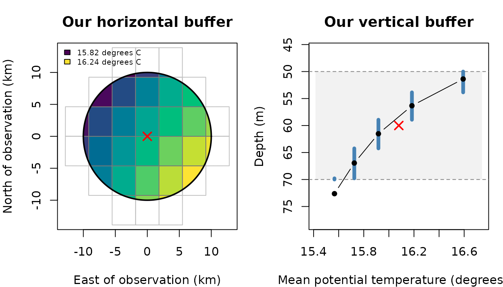
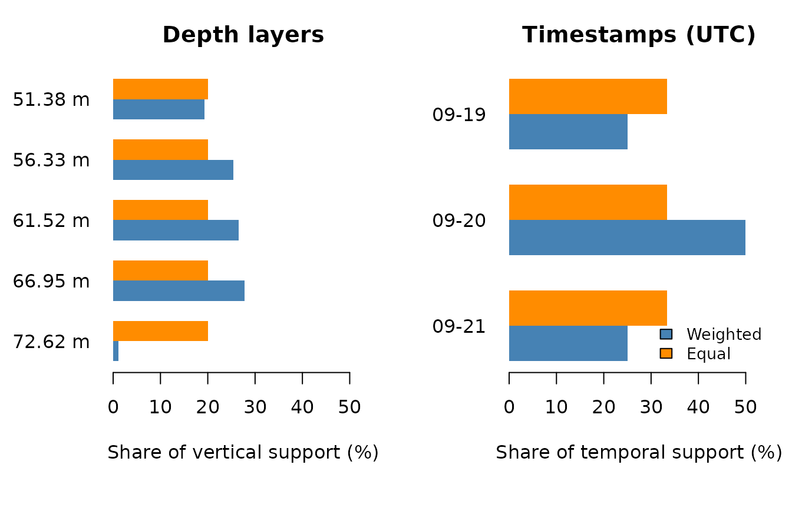

# Extracting environmental data around observation points

Environmental observations are often associated with a single location,
depth and time. However, the conditions experienced by a marine animal
may extend beyond that exact point. An animal may move between
neighbouring cells, occupy several depths or encounter changing
temperatures over time.

Similarly, a fishing operation may extend across space and time rather
than occur at one exact point. A longline may span several kilometres
and remain deployed for hours, while a trawl moves through an area
during a tow. In these situations, we may want to describe environmental
conditions around the recorded location, across relevant depths and over
the duration of the operation.

Rather than selecting one environmental value, we may therefore want to
describe the conditions within a surrounding volume and time window.

**How can we summarise these conditions, and why might two averages of
the same data give different results?**

In this tutorial, we will use
[`extract_to_buffer()`](https://marine-biodiversity-conservation-lab.github.io/ocean3d/reference/extract_to_buffer.md)
to explore this question with a small example of Mediterranean Sea
potential temperature. We will build a buffer around one observation,
compare two ways of calculating its mean and examine how individual
cells, layers and timestamps contribute.

## Our research question

Imagine we have recorded a marine animal at:

- Longitude 0 degrees and latitude 38 degrees.
- A depth of 60 metres.
- Midnight UTC on 20 September 2026.

We would like to describe the temperature conditions within 10
kilometres of this location, between 50 and 70 metres deep, and from one
day before to one day after the observation.

Our question concerns a **surrounding volume over time**, rather than
the single closest temperature measurement. This distinction determines
both which values contribute and how much weight each value receives.

To keep the example reproducible, this article includes a small netCDF
subset and the geometry used for its figures. No external download or
API credentials are required. These are real modelled temperatures, not
artificially generated observations. Their source is described at the
end.

## Getting started: preparing our data

The article files are in `vignettes/articles/` in the source repository.
When running these examples manually, use that directory as your working
directory. The website runs the examples using the same relative paths.

``` r

library(ocean3d)

# Locate the small netCDF provided with this article.
example_dir <- "buffer-data"
nc_file <- file.path(example_dir, "temperature-subset.nc")

# Load the article's display data and plotting helpers.
example <- readRDS(file.path(example_dir, "temperature-geometry.rds"))
source(file.path(example_dir, "figures.R"))
```

The plotting helpers belong to this article; they are not exported
`ocean3d` functions. Extraction itself uses the netCDF directly.

We begin by placing our observation in a table. Longitude and latitude
are in decimal degrees, and depth is positive downwards, in metres. We
specify UTC explicitly so that the observation has an unambiguous time.

``` r

observation <- data.frame(
  id = "observation_1",
  lon = 0,
  lat = 38,
  depth = 60,
  date = as.POSIXct("2026-09-20 00:00:00", tz = "UTC")
)

observation
#>              id lon lat depth       date
#> 1 observation_1   0  38    60 2026-09-20
```

## Step 1: Defining the space and time around our observation

A horizontal radius of 10 kilometres defines a circle around our
location. A depth radius of 10 metres extends 10 metres above and below
the requested 60 metres. Our temporal window extends one day in each
direction.

The result is a cylinder from 50 to 70 metres deep, considered over a
48-hour period. We do not extend the cylinder to the sea surface.

Let’s first examine the horizontal footprint and the temperature layers
available in this part of the water column.

``` r

plot_buffer_footprint(example)
```



*Figure 1. Our requested buffer in horizontal and vertical views. Left:
the circle marks the 10 km radius and the red cross marks the
observation. Grid cells are coloured by their weighted mean potential
temperature within the requested depth and time window; only their
intersecting parts are filled. Right: black points show the centres of
the contributing layers, and blue segments show the thickness used from
each layer. The shaded band is the requested 50-70 m interval. The red
cross marks the requested depth; its horizontal position is
illustrative.*

### 1.1. Understanding what a layer represents

The centre of a layer is a coordinate, not its full vertical extent. To
determine how much of a layer lies inside our buffer, we also need its
upper and lower boundaries. The same applies to geographical cells and
temporal intervals.

Some netCDF files provide these boundaries explicitly, using `bounds`
variables. Our example does not. We therefore use `infer_bounds = TRUE`
to estimate boundaries halfway between neighbouring coordinate centres.
At the outer edges, half of the adjacent gap is extrapolated.

**These are assumptions about represented support.** In particular,
inferring temporal boundaries does not establish the physical averaging
period of the source product. The source metadata describes these data
as daily means; the boundaries used here are still inferred by the
function.

## Step 2: Extracting a weighted mean

Now that we have defined our buffer, let’s calculate its mean
temperature.

``` r

weighted <- extract_to_buffer(
  data = observation,
  nc = nc_file,
  var = "thetao",
  horizontal_radius_km = 10,
  depth_radius_m = 10,
  time_before = 1,
  time_after = 1,
  time_unit = "days",
  statistic = "mean",
  weighting = "weighted",
  infer_bounds = TRUE,
  output_col = "temperature"
)

weighted[, c("id", "temperature")]
#>              id temperature
#> 1 observation_1    16.05743
```

The original observation is retained and a new column contains its
summary. Here, the weighted mean is approximately **16.05743 degrees
C**.

The function also returns a diagnostic list column. Let’s inspect the
parts that describe coverage and the number of values used.

``` r

information <- weighted$temperature_match_info[[1]]

information[c(
  "coverage_fraction", "valid_fraction", "n_intersecting",
  "n_valid", "status"
)]
#> $coverage_fraction
#> [1] 1
#> 
#> $valid_fraction
#> [1] 1
#> 
#> $n_intersecting
#> [1] 450
#> 
#> $n_valid
#> [1] 450
#> 
#> $status
#> [1] "complete"
```

There are 450 valid values: **30 geographical cells, five depth layers
and three timestamps**. Both coverage fractions are one, meaning that
the entire requested support is covered and contains valid data.

This does not mean that the 450 values must have equal weights.

## Step 3: Comparing weighted and equal means

Let’s repeat the same extraction, changing only the weighting rule.

``` r

equal <- extract_to_buffer(
  data = observation,
  nc = nc_file,
  var = "thetao",
  horizontal_radius_km = 10,
  depth_radius_m = 10,
  time_before = 1,
  time_after = 1,
  time_unit = "days",
  statistic = "mean",
  weighting = "equal",
  infer_bounds = TRUE,
  output_col = "temperature"
)

data.frame(
  weighted = weighted$temperature,
  equal = equal$temperature
)
#>   weighted    equal
#> 1 16.05743 15.98204
```

The equal-weight mean is approximately **15.98204 degrees C**. Both
means use exactly the same valid values, but answer slightly different
questions:

- **Equal:** what is the average of the selected values, with every
  value counting once?
- **Weighted:** what is the average over the represented volume and
  time, with each value weighted by the support inside our buffer?

For the weighted calculation, a sample’s contribution is proportional to
its intersecting area, thickness and duration. These contributions are
normalised over the valid samples when calculating the mean.

### 3.1. Why complete coverage does not imply equal weights

Consider a cell at the edge of the circle. Only a small part of its area
may lie inside our requested buffer. With equal weighting, its value
counts as much as that of a cell lying entirely inside the circle. With
weighted extraction, its smaller intersecting area gives it less weight.

The same principle applies to the vertical and temporal boundaries.

``` r

plot_buffer_weights(example)
```



*Figure 2. Comparing the contribution of depth layers and timestamps.
Blue bars show their shares of the requested vertical or temporal
support; orange bars show their shares when every selected value has
equal weight. These are marginal shares for this fully covered example.
A sample’s final weight also depends on its horizontal intersection and
the other axis.*

The deepest selected layer is a useful example. Its centre is at 72.62
m, below our requested maximum depth. However, its inferred upper
boundary is at approximately 69.79 m, so about 0.21 m of the layer lies
inside the requested interval.

Equal weighting assigns this layer the same vertical share as the other
four layers: 20%. Weighted extraction assigns it about 1.07%, reflecting
the thickness actually included. In these data, this layer is colder;
reducing its weight contributes to the higher weighted mean.

**We have not extended the extraction below 70 m.** The temperature at
the layer centre represents the intersecting part of its inferred layer.
No vertical interpolation is performed.

Similarly, the three selected timestamps represent different fractions
of our 48-hour window: 12 hours, 24 hours and 12 hours. With equal
weights, each timestamp receives one third of the temporal contribution
instead.

## Step 4: Exploring our buffer in three dimensions

We can now bring the horizontal, vertical and temporal views together.

``` r

buffer_explorer(example, file.path(example_dir, "explorer.js"))
```

*Figure 3. Interactive view of the potential temperatures used in the
extraction. Rotate the volume and select a date or depth layer to
inspect the contributing values. Switch to the horizontal footprint to
see how the circular buffer cuts through the grid. Colour can represent
either temperature or contribution weight. Each 3D prism represents a
cell-layer intersection at the selected timestamp, rather than a
`SpatVoxel` object. Depth is visually exaggerated and is not drawn at
the horizontal scale. Displayed polygon edges are simplified by up to 5
m; calculation weights use the unsimplified geometry. Controls change
the display, not the requested buffer; the reported mean always refers
to all 450 values.*

When looking at the contribution weights, remember that the equal rule
assigns each of the 450 values a weight of 1/450. With weighted
extraction, the weight changes with the intersecting area, thickness and
duration. Changing the date or layer helps us see these differences
without changing the extraction itself.

The figures use stored display data to keep the article lightweight. The
preparation script reconstructs their support independently from the
netCDF coordinates and checks its aggregate against
[`extract_to_buffer()`](https://marine-biodiversity-conservation-lab.github.io/ocean3d/reference/extract_to_buffer.md).
The rounded means displayed above are also calculated directly from the
supplied netCDF when this article is built.

## Step 5: Describing variability and extreme values

The mean is only one way to describe conditions around an observation.
We can also request the standard deviation, standard error, minimum or
maximum. Each call calculates one statistic per observation and
variable.

``` r

statistics <- c("mean", "sd", "se", "min", "max")

summaries <- lapply(statistics, function(statistic) {
  result <- extract_to_buffer(
    data = observation,
    nc = nc_file,
    var = "thetao",
    horizontal_radius_km = 10,
    depth_radius_m = 10,
    time_before = 1,
    time_after = 1,
    statistic = statistic,
    weighting = "weighted",
    infer_bounds = TRUE,
    output_col = "temperature"
  )

  data.frame(statistic = statistic, temperature = result$temperature)
})

do.call(rbind, summaries)
#>   statistic temperature
#> 1      mean 16.05742847
#> 2        sd  0.34459073
#> 3        se  0.02306576
#> 4       min 15.44085979
#> 5       max 17.17307854
```

SD describes variation among selected values, using the sample variance
correction for the selected weights. SE divides this SD by the square
root of the effective sample size. With equal weights, these reduce to
ordinary sample SD and SD divided by the square root of the sample
count. Both need at least two valid samples with usable weights.

Neighbouring cells and dates can be correlated. **SE assumes
independence; it does not correct spatial or temporal autocorrelation.**
It should not automatically be interpreted as the uncertainty of the
environmental mean. The effective sample size describes weight
concentration, not the number of independent ocean measurements.

Minimum and maximum use the valid values with positive intersecting
support, regardless of the magnitude of their weights. They are still
subject to the same valid-coverage requirement.

## Step 6: Understanding partial coverage and rejected requests

So far, our buffer has been fully covered. For another observation, the
requested depth or time window might extend beyond the available data,
or some selected values might be missing.

By default, `min_valid_fraction = 0.8` requires at least 80% of the
**entire requested support** to contain valid values. Missing values and
uncovered portions reduce this fraction. It is not the proportion of
selected rows that happen to be non-missing.

The supplied netCDF is deliberately small. Let’s request a wider
temporal window than it contains.

``` r

too_wide <- extract_to_buffer(
  data = observation,
  nc = nc_file,
  var = "thetao",
  depth_radius_m = 10,
  time_before = 10,
  time_after = 10,
  infer_bounds = TRUE,
  output_col = "temperature"
)
#> Buffer report: 1 observation(s) need attention.
#> netCDF variable: thetao · output column: temperature
#> Row 1: Valid coverage is below minimum; result: NA. Coverage: 25%; valid: 25%; required: 80%. 
#> Check coordinates, source coverage and missing values. Change the window or threshold only if appropriate for your analysis.

too_wide$temperature
#> [1] NA
too_wide$temperature_match_info[[1]][c("status", "valid_fraction")]
#> $status
#> [1] "insufficient_coverage"
#> 
#> $valid_fraction
#> [1] 0.25
```

The result is `NA` because valid coverage is below the requested
threshold. Reducing that threshold can accept a partial result, but it
does not fill missing data or make the source cover a larger period. Any
such change should reflect the needs of the analysis.

A different situation occurs when the observation’s date is explicitly
missing. The row is retained, with an `NA` summary and a diagnostic.

``` r

missing_date <- observation
missing_date$date <- as.POSIXct(NA, tz = "UTC")

missing_result <- extract_to_buffer(
  data = missing_date,
  nc = nc_file,
  var = "thetao",
  depth_radius_m = 10,
  infer_bounds = TRUE,
  output_col = "temperature"
)
#> Buffer report: 1 observation(s) need attention.
#> netCDF variable: thetao · output column: temperature
#> Row 1: The observation date is NA; result: NA. 
#> Check coordinates, source coverage and missing values. Change the window or threshold only if appropriate for your analysis.

missing_result[, c("id", "temperature")]
#>              id temperature
#> 1 observation_1          NA
```

Invalid settings instead produce an error. For example, the following
request does not permit the bounds inference required by our file:

``` r

extract_to_buffer(
  data = observation,
  nc = nc_file,
  var = "thetao",
  depth_radius_m = 10,
  infer_bounds = FALSE
)
#> Error:
#> ! Coordinate `depth` has no explicit bounds. Use a dataset with bounds or explicitly set `infer_bounds = TRUE` to estimate midpoint intervals.
```

This error is intentional. Using `infer_bounds = TRUE` is an explicit
choice about support, not a repair for invalid bounds declared by a
file. A single coordinate without bounds does not provide enough
information to infer its width or duration.

## Selecting values similar to a measurement

A recorded temperature may help us ask a different question from a
buffer mean: **which available environmental value is most similar to
this measurement within a specified neighbourhood?** For example, a tag
may record temperature while its location or depth is uncertain.

This workflow selects an existing environmental value. It does not
locate the animal, demonstrate where a measurement was taken, or
interpolate a new temperature. Several locations can have the same
winning value.

### Getting started: preparing our data

We use the same real Copernicus Marine subset as the [point
tutorial](https://marine-biodiversity-conservation-lab.github.io/ocean3d/articles/extracting-environmental-data-at-points.md).
Run from `vignettes/articles/`. The location and measurement are
fictional examples.

``` r

library(ocean3d)
target_nc <- file.path("point-data", "temperature-points.nc")
target_observation <- data.frame(
  lon = 0, lat = 38, depth = 60, date = as.Date("2026-09-20"),
  recorded_temperature = 16
)
```

### Step 1: Selecting the most similar available value

``` r

selected <- extract_to_buffer(
  target_observation, target_nc, var = "thetao", output_col = "temperature",
  horizontal_radius_km = 10, depth_radius_m = 10,
  statistic = "most_similar", target_col = "recorded_temperature",
  infer_bounds = TRUE, quiet = TRUE
)
selected[c("recorded_temperature", "temperature")]
#>   recorded_temperature temperature
#> 1                   16    15.99929
```

The target column must be numeric and use the netCDF variable’s units.
Its physical definition must also agree. This subset contains potential
temperature (thetao); an in-situ sensor temperature is not automatically
equivalent. Our fictional target is assumed compatible for this example.
For temperature, convert explicitly if your measurement uses a different
scale. For several variables, use a named mapping such as
`target_col = c(thetao = "recorded_temperature", so = "recorded_salinity")`.

Cells and layers contribute where their support intersects the buffer.
Their coordinate centres may lie outside a window even though part of
their support lies inside it; the same intersection rules as ordinary
buffer summaries apply.

The function considers valid values inside the requested buffer and
minimises their absolute difference from the row’s target. Area,
thickness and duration determine coverage; larger support does not make
a less similar value win. `weighting` still governs ordinary buffer
summaries.

### Step 2: Inspecting the actual winning locations

``` r

info <- selected$temperature_match_info[[1]]
info[c("coverage_fraction", "valid_fraction", "status")]
#> $coverage_fraction
#> [1] 1
#> 
#> $valid_fraction
#> [1] 1
#> 
#> $status
#> [1] "complete"
info$target_match[c("target", "value", "absolute_difference")]
#> $target
#> [1] 16
#> 
#> $value
#> [1] 15.99929
#> 
#> $absolute_difference
#> [1] 0.0007123947
info$target_match$matches
#>       value                      source_file  longitude latitude  depth_m
#> 42 15.99929 point-data/temperature-points.nc -0.1249998 37.97917 56.33429
#>    timestamp_utc lon_index lat_index depth_index time_index
#> 42    2026-09-20         2         4          17          2
```

For `most_similar`, the winning coordinates are also ordinary output
columns:

``` r

selected[c(
  "lon", "lat", "temperature", "temperature_match_lon", "temperature_match_lat",
  "temperature_match_depth", "temperature_match_time"
)]
#>   lon lat temperature temperature_match_lon temperature_match_lat
#> 1   0  38    15.99929            -0.1249998              37.97917
#>   temperature_match_depth temperature_match_time
#> 1                56.33429             2026-09-20
```

The original coordinates stay unchanged. The new longitude and latitude
locate the model cell centre; depth and UTC time describe the winning
model record. They are returned even with `return_match_info = FALSE`.
They describe an environmental candidate, not proof that an observation
occurred there. A cell centre can lie outside the buffer when only part
of its support intersects it. Review that support before using a centre
to revise a position.

If several winning records share a single horizontal location, that
longitude and latitude are still returned. Depth or time is `NA` when it
is ambiguous. If several horizontal locations remain, both longitude and
latitude are `NA`. All winners remain in `target_match$matches`, and the
function warns with affected rows and instructions. `quiet = TRUE` does
not hide that warning. Depth or time is also `NA` when the variable has
no corresponding axis; that absence alone is not an ambiguity warning.
Coverage status such as `complete` describes available support, while
`target_match$location_status` describes whether a unique winning
location could be assigned.

The matches table contains all locations with the selected winning
value, including file, cell centre, model depth and UTC timestamp. These
are environmental records, not estimated observation coordinates.
Identical winning values at multiple locations are retained rather than
choosing the first file or claiming a unique location.

### Step 3: Understanding ties and limits

If the target is 20 and the available values are 17, 19 and 24, the
function selects 19: their absolute differences are 3, 1 and 4. No tie
rule is needed. If the best values are 19 and 21, both differ by one.
Only then does `target_ties` decide between different equally good
values:

| `target_ties`    | Result for target 20 and winners 19, 21    |
|:-----------------|:-------------------------------------------|
| `"NA"` (default) | `NA`, with the tied records in diagnostics |
| `"lower"`        | 19                                         |
| `"higher"`       | 21                                         |

These options never select a less similar value. They do not take the
minimum or maximum of the entire buffer, and they never average a tie.

`lower` and `higher` refer to the **environmental value**, not
shallower/deeper layers or smaller/larger coordinates. To demonstrate
this with the real data, use a very narrow depth window across the
boundary between two model layers:

``` r

handle <- ncdf4::nc_open(target_nc)
depth_centres <- handle$dim$depth$vals
ncdf4::nc_close(handle)
first_layer <- which.min(abs(depth_centres - 60))
pair <- target_observation[rep(1, 2), ]
pair$depth <- depth_centres[c(first_layer, first_layer + 1)]
pair <- extract_to_point(
  pair, target_nc, var = "thetao", method = "nearest", output_col = "temperature",
  time_report = FALSE, spatial_report = FALSE, depth_report = FALSE
)
pair[c("depth", "temperature")]
#>        depth temperature
#> 1   61.52196    15.94670
#> 1.1 66.94949    15.74077
tie_observation <- target_observation
tie_observation$depth <- mean(pair$depth)
tie_observation$recorded_temperature <- mean(pair$temperature)
```

The two layer centres have different temperatures. The target is exactly
their midpoint, so both are equally similar. The following call
deliberately warns and returns `NA` for the value and location rather
than choosing a layer:

``` r

tied <- extract_to_buffer(
  tie_observation, target_nc, var = "thetao", output_col = "temperature",
  depth_radius_m = 0.1, statistic = "most_similar",
  target_col = "recorded_temperature", infer_bounds = TRUE, quiet = TRUE
)
#> Warning: most_similar could not assign a unique location for output
#> `temperature` in 1 row(s). Rows: 1. Ambiguous location fields are NA; original
#> coordinates are retained. Use return_match_info = TRUE and inspect
#> `temperature_match_info[[1]]$target_match$matches` (or $ties for tied values).
#> For equally similar different values, choose target_ties = 'lower' or 'higher'
#> only if justified.
tied[c("temperature", "temperature_match_lon", "temperature_match_depth")]
#>   temperature temperature_match_lon temperature_match_depth
#> 1          NA                    NA                      NA
tied$temperature_match_info[[1]]$target_match$ties
#>      value                      source_file    longitude latitude  depth_m
#> 1 15.94670 point-data/temperature-points.nc 1.803995e-07 37.97917 61.52196
#> 2 15.74077 point-data/temperature-points.nc 1.803995e-07 37.97917 66.94949
#>   timestamp_utc lon_index lat_index depth_index time_index
#> 1    2026-09-20         5         4          18          2
#> 2    2026-09-20         5         4          19          2
```

If the study justifies choosing the cooler or warmer value, request that
explicitly. Both calls use the same two candidates and target:

``` r

cooler <- extract_to_buffer(
  tie_observation, target_nc, var = "thetao", output_col = "temperature",
  depth_radius_m = 0.1, statistic = "most_similar",
  target_col = "recorded_temperature", target_ties = "lower",
  infer_bounds = TRUE, quiet = TRUE
)
warmer <- extract_to_buffer(
  tie_observation, target_nc, var = "thetao", output_col = "temperature",
  depth_radius_m = 0.1, statistic = "most_similar",
  target_col = "recorded_temperature", target_ties = "higher",
  infer_bounds = TRUE, quiet = TRUE
)
data.frame(
  policy = c("NA", "lower", "higher"),
  selected = c(tied$temperature, cooler$temperature, warmer$temperature),
  depth_m = c(tied$temperature_match_depth, cooler$temperature_match_depth,
              warmer$temperature_match_depth)
)
#>   policy selected  depth_m
#> 1     NA       NA       NA
#> 2  lower 15.74077 66.94949
#> 3 higher 15.94670 61.52196
```

There is a different ambiguity when the **same winning value** occurs in
several cells. For a target of 16 degrees C, two cells both containing
16 remain equally valid under all three `target_ties` settings. The
value stays 16, ambiguous location fields stay `NA`, and a warning
recommends inspecting `target_match$matches`. Narrow the search or apply
an independently justified location rule; selecting the first file or
averaging the coordinates would invent a location. Lower/higher cannot
resolve this kind of tie.

If a difference smaller than a scientific tolerance is required, set
`max_target_difference` explicitly, in the same units as the variable.

``` r

exact_only <- extract_to_buffer(
  target_observation, target_nc, var = "thetao", output_col = "temperature",
  horizontal_radius_km = 10, depth_radius_m = 10,
  statistic = "most_similar", target_col = "recorded_temperature",
  max_target_difference = 0, infer_bounds = TRUE, quiet = TRUE
)
exact_only$temperature
#> [1] NA
exact_only$temperature_match_info[[1]]$status
#> [1] "outside_target_limit"
```

A limit of zero requires an exact numeric match. `NA` here means no
acceptable candidate was found, not that the measurement is invalid.

### Step 4: Seeing how the selected value changes with the target

Hold the buffer fixed and vary only the target. Hover over the
interactive figure to compare each requested and selected temperature.
The dashed line shows an exact match. The available model records limit
which values can be selected, however finely we vary the target.

The horizontal axis is the target we supply; the vertical axis is the
value actually extracted. Each blue point is a separate extraction from
the same buffer. We are not changing its location, depth, date or
radius, and no new environmental temperatures are created between the
available model values. The connecting blue line only helps follow these
eleven results.

``` r

targets <- target_observation[rep(1, 11), ]
targets$recorded_temperature <- seq(15.5, 16.5, length.out = 11)
comparison <- extract_to_buffer(
  targets, target_nc, var = "thetao", output_col = "temperature",
  horizontal_radius_km = 10, depth_radius_m = 10,
  statistic = "most_similar", target_col = "recorded_temperature",
  infer_bounds = TRUE, quiet = TRUE
)
figure <- plotly::plot_ly(
  comparison, x = ~recorded_temperature, y = ~temperature,
  type = "scatter", mode = "lines+markers", name = "Selected model value",
  hovertemplate = "Target: %{x:.5f} C<br>Selected: %{y:.5f} C<extra></extra>"
)
figure <- plotly::add_trace(figure,
  x = ~recorded_temperature, y = ~recorded_temperature,
  type = "scatter", mode = "lines",
  name = "Exact target", line = list(dash = "dash"), inherit = FALSE)
figure <- plotly::layout(figure,
  xaxis = list(title = "Target temperature (C)"),
  yaxis = list(title = "Selected temperature (C)"),
  legend = list(orientation = "h", y = -0.2), margin = list(b = 85))
figure <- plotly::config(figure, displaylogo = FALSE, responsive = TRUE)
htmlwidgets::onRender(figure, paste0(
  "function(el,x){el.style.width='100%';",
  "function resize(){window.Plotly.Plots.resize(el);}",
  "window.addEventListener('resize',resize);resize();}"
))
```

Figure 4. Blue points show existing model values selected for eleven
different targets in the same fixed buffer. The dashed line represents
an exact target match. Their near-overlap reflects small selection
differences, not environmental interpolation.

Here the buffer contains many distinct temperatures close to the
targets, so the blue points almost overlap the dashed line. Above the
dashed line, the selected value is warmer than requested; below it, it
is cooler. Near-overlap does not establish exact equality. These
examples reveal the small differences that are difficult to see at the
figure’s scale:

``` r

examples <- comparison[c(1, 6, 11), ]
knitr::kable(data.frame(
  Target = examples$recorded_temperature,
  Selected = examples$temperature,
  Difference = examples$temperature - examples$recorded_temperature
), digits = 5, caption = "Temperatures and selected-minus-target differences, in degrees C.")
```

| Target | Selected | Difference |
|-------:|---------:|-----------:|
|   15.5 | 15.50246 |    0.00246 |
|   16.0 | 15.99929 |   -0.00071 |
|   16.5 | 16.49405 |   -0.00595 |

Temperatures and selected-minus-target differences, in degrees C.
{.table}

Five decimal places make this numerical comparison visible; they do not
imply that the environmental product has that measurement accuracy. With
fewer distinct candidates, several nearby targets could select the same
value, producing flat sections instead. An equally good tie between
different values would give `NA` under the default tie policy.
Connecting points with a line does not imply that all intermediate
targets were tested.

### Step 5: Understanding missing values and coverage

`most_similar` accepts any positive valid support by default. A value
from only a small part of a buffer can therefore win; inspect
`valid_fraction`. Set `min_valid_fraction = 0.8` explicitly if at least
80% must be available. Ordinary mean, SD, SE, minimum and maximum retain
their 80% default. An empty or entirely missing buffer always returns
`NA`, even at threshold zero.

``` r

missing_target <- target_observation
missing_target$recorded_temperature <- NA_real_
missing_result <- extract_to_buffer(
  missing_target, target_nc, var = "thetao", horizontal_radius_km = 10,
  statistic = "most_similar", target_col = "recorded_temperature",
  infer_bounds = TRUE, quiet = TRUE
)
missing_result$thetao
#> [1] NA
missing_result$thetao_match_info[[1]]$status
#> [1] "missing_target"
```

A missing target preserves the observation and returns `NA`. Text or
infinite targets are rejected with an explanation of the affected input.
Changing coverage or similarity limits changes the scientific question;
it is not an automatic correction of incomplete observations.

## Summary

We have described the environmental conditions around an observation
using horizontal, vertical and temporal buffers. Along the way, we have:

1.  Defined a requested volume and time window.
2.  Extracted weighted and equal means from the same real temperature
    values.
3.  Examined how cell intersections, layer thicknesses and temporal
    support produce different contribution weights.
4.  Explored these values in three dimensions and calculated other
    statistics.
5.  Distinguished complete coverage, missing results and invalid
    requests.

A buffer does not need to extend along all three axes. For example,
`horizontal_radius_km = 10` alone averages over a circle while retaining
point selection in depth and time. Alternatively,
`depth_layer_radius = 1` requests a three-layer neighbourhood rather
than a fixed number of metres. Index windows that extend beyond the grid
are rejected because their full physical support is unknown.

### Next steps

- See
  [`extract_to_buffer()`](https://marine-biodiversity-conservation-lab.github.io/ocean3d/reference/extract_to_buffer.md)
  for the full set of window, coverage and output options.
- Use
  [`extract_to_point()`](https://marine-biodiversity-conservation-lab.github.io/ocean3d/reference/extract_to_point.md)
  when the question concerns a selected cell and layer rather than a
  surrounding buffer.
- Return to [Getting started with
  ocean3d](https://marine-biodiversity-conservation-lab.github.io/ocean3d/articles/ocean3d.md)
  to explore species’ three-dimensional distributions with
  `SpatEnvelope` and `SpatVoxel` objects.

For temporal windows, days are 24 elapsed hours; months and years are
whole calendar shifts in UTC. Multiple complementary files are combined
before assessing coverage. Overlapping selected support is rejected
rather than silently counted twice. Neither reduced calendar precision
nor inferred bounds performs a temporal aggregation or reconstructs the
physical averaging period of a source product.

## Data sources and reproducibility

The example is a subset of **Mediterranean Sea Physics Reanalysis**,
product `MEDSEA_MULTIYEAR_PHY_006_004`, dataset
`cmems_mod_med_phy-temp_my_4.2km_P1D-m_202511`. It contains the original
`thetao` values and coordinate centres from a download made on 19
October 2026. The original metadata identifies CMCC as the producer and
describes the data as daily mean potential temperature.

E.U. Copernicus Marine Service Information;
<https://doi.org/10.48670/mds-00375>. The subset and derived figures
retain this attribution. Source data remain subject to the [Copernicus
Marine Service
licence](https://marine.copernicus.eu/user-corner/service-commitments-and-licence).
The figures do not imply endorsement by Copernicus Marine or CMCC.

The article’s
[`buffer-data/README.md`](https://github.com/Marine-Biodiversity-Conservation-Lab/ocean3d/blob/main/vignettes/articles/buffer-data/README.md)
records the subset and its preparation. The repository script
[`data-raw/buffer-article.R`](https://github.com/Marine-Biodiversity-Conservation-Lab/ocean3d/blob/main/data-raw/buffer-article.R)
regenerates the subset and display data from the downloaded original. It
keeps neighbouring coordinates so that the inferred bounds and the
extracted mean match the larger file. It does not add explicit bounds or
alter the original temperature values.

## All arguments and defaults

Expand or collapse the complete extract_to_buffer() signature

This signature is generated from the current function. Arguments without
a default require input. Where a vector lists alternatives, its first
entry is the default; supply one alternative in a call.

``` r

extract_to_buffer(
  # Data and sources
  data, nc, var = NULL,

  # Horizontal buffer
  horizontal_radius_km = 0, lon_cell_radius = NULL, lat_cell_radius = NULL,

  # Depth buffer
  depth_radius_m = 0, depth_layer_radius = NULL,

  # Time buffer
  time_before = 0, time_after = 0,
  time_unit = c("days", "hours", "minutes", "seconds", "months", "years"),

  # Statistics inside each buffer
  statistic = "mean", weighting = c("weighted", "equal"),

  # Valid coverage and bounds
  min_valid_fraction = NULL, infer_bounds = FALSE,

  # Similar-value selection
  target_col = NULL, max_target_difference = NULL,
  target_ties = c("NA", "lower", "higher"),

  # Depth selection
  method = NULL,

  # Observation and output columns
  lon_col = "lon", lat_col = "lat", depth_col = "depth", date_col = "date",
  output_col = NULL, id_col = NULL,

  # Source columns and dimensions
  file_col = "file", lon_dim = NULL, lat_dim = NULL, depth_dim = NULL,
  time_dim = NULL,

  # Temporal selection
  time_match = c("nearest", "exact"),
  time_resolution = c("auto", "datetime", "daily", "monthly", "yearly"),
  max_time_diff = NULL,

  # Spatial selection
  spatial_match = c("within", "nearest"), max_distance_km = NULL,

  # Diagnostics and messages
  return_match_info = TRUE, quiet = FALSE
)
```

Some decisions need more context than a default value alone:

| Decision | Choices, meaning and effective default |
|:---|:---|
| Data and variables | `data` supplies observations; `nc` supplies sources. `var = NULL` detects variables, or supply names explicitly. `output_col = NULL` chooses output names automatically. |
| Horizontal window | `horizontal_radius_km = 0` keeps point selection; a positive radius requests a circle. Alternatively, nonnegative integer `lon_cell_radius` / `lat_cell_radius` select neighbouring cells. Physical and index radii cannot be combined on that axis. |
| Depth and time windows | `depth_radius_m = 0` and `time_before = time_after = 0` keep point selection on those axes. Positive values extend the buffer; `depth_layer_radius` selects neighbouring layers instead of metres. At least one window must be positive. |
| `time_unit` | `"seconds"`, `"minutes"`, `"hours"`, `"days"` are elapsed units (days = 24 hours); `"months"` and `"years"` are whole UTC calendar shifts, clamped at month ends. Default: `"days"`. |
| `statistic` | `"mean"` averages values; `"sd"` describes spread; `"se"` reports the standard error; `"min"` / `"max"` return the lowest / highest value. `"most_similar"` selects the available value nearest the target. Default: `"mean"`; choose one. |
| `weighting` | `"weighted"` (default) weights intersecting area, layer thickness and temporal support; `"equal"` gives valid contributing records equal weight. This does not change which value is most similar. |
| `min_valid_fraction` | NULL (default) resolves to 0.8 for ordinary statistics or 0 for most_similar (any positive valid support). Choose a fraction from 0 to 1; empty support still gives NA. |
| `infer_bounds` | FALSE (default) requires available support bounds; TRUE permits documented inference from coordinate centres. |
| `method` | `"2d"` has no depth selection; `"nearest"` selects the closest valid layer to the requested depth; `"surface"` selects the physically shallowest layer; `"bottom"` selects the deepest valid layer. NULL (default) chooses per variable on unbuffered axes; `"all"` is unavailable. |
| Temporal selection | `time_match = "nearest"` (default) chooses the nearest eligible label; `"exact"` requires the requested label. `"auto"` follows observation precision; `"datetime"` preserves instants; `"daily"`, `"monthly"`, `"yearly"` compare UTC calendar labels. Default: `"auto"`; custom is unavailable. `max_time_diff = NULL` has no extra distance limit; supply nonnegative days to impose one. |
| Spatial selection | `spatial_match = "within"` (default) selects containing cells on point-selected axes; `"nearest"` allows a nearby cell only within an explicit `max_distance_km`. That distance limit defaults to NULL. |
| Targets and difference limit | `target_col` names a numeric target column (or a named mapping by variable); `max_target_difference = NULL` imposes no extra limit, a nonnegative number limits absolute difference (0 requires equality). |
| `target_ties` | `"NA"` (default) returns NA with a warning for equally close different values; `"lower"` / `"higher"` choose the smaller / larger value. Repeated locations with the same winning value remain ambiguous; these choices do not pick a location. |
| Input and source names | `lon_col`, `lat_col`, `depth_col`, `date_col` default to lon, lat, depth, date. `id_col = NULL` means no ID column; `file_col = "file"` names the source-table path column. Dimension names default to NULL (detect); set lon_dim, lat_dim, depth_dim or time_dim to override. |
| Diagnostics | `return_match_info = TRUE` (default) keeps full diagnostics; FALSE omits them. Most-similar coordinate columns remain available in both cases. |
| Messages | `quiet = FALSE` (default) permits reports; TRUE hides ordinary reports while timezone and unresolved-location warnings remain active. |

See
[`extract_to_buffer()`](https://marine-biodiversity-conservation-lab.github.io/ocean3d/reference/extract_to_buffer.md)
for parameter units, accepted inputs, matching rules and the complete
return description.
