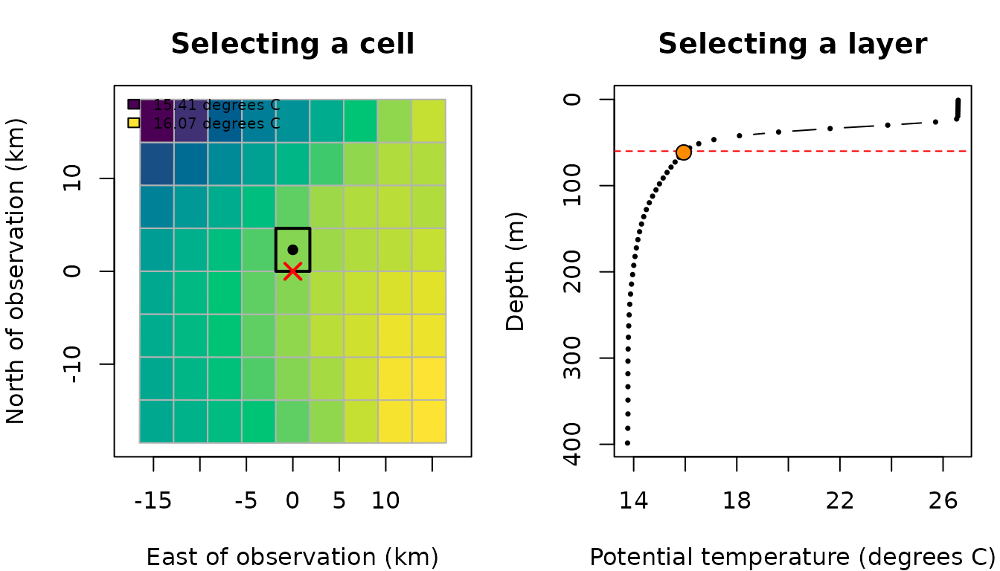

# Extracting environmental conditions at observation points

Marine observations often come with a geographical location, a depth and
a date. These may describe an animal location recorded by a tracking
device, an observation from a baited remote underwater video system
(BRUV), a fishing operation or another type of marine survey. In each
case, we may know where and when an observation was recorded but still
need to identify its associated environmental conditions.

An environmental dataset rarely contains a measurement at precisely the
same coordinates, depth and instant. Instead, it provides values on a
grid, at particular depth levels and timestamps. Before assigning a
temperature to an observation, we therefore need to decide which of
these values represents the observation’s conditions.

**What environmental conditions correspond to each fishing observation,
and how do our selection rules affect the answer?**

In this tutorial, we will use
[`extract_to_point()`](https://marine-biodiversity-conservation-lab.github.io/ocean3d/reference/extract_to_point.md)
and its convenience functions to answer this question. We will follow
one observation through the horizontal, vertical and temporal
selections, then extend the workflow to several observations and netCDF
files.

## Our research question

Imagine we have a small table of fishing records. For each record, we
know:

- Its longitude and latitude, in decimal degrees.
- Its recorded depth, in metres below the reference surface.
- Its date and time, with a known time zone.

We would like to add potential temperature at the nearest valid depth,
compare this with surface and deeper conditions, and understand where
the returned values came from.

The fishing records below are **fictional teaching observations**. The
temperatures are real modelled values from a small Copernicus Marine
subset. No external downloads or credentials are needed to run this
article.

A point selection describes the recorded location, rather than the full
extent of a longline or the path of a trawl. If our question concerns
conditions throughout a surrounding volume and time window, the [buffer
extraction
tutorial](https://marine-biodiversity-conservation-lab.github.io/ocean3d/articles/extracting-and-weighting-buffer-data.md)
provides a complementary workflow.

## Getting started: preparing our data

The example files accompany this article in the repository’s
`vignettes/articles/point-data/` directory. To run the code manually,
use `vignettes/articles/` as your working directory, as when building
the article.

``` r

library(ocean3d)

# Locate the small real-data subset supplied with this article.
example_dir <- "point-data"
nc_file <- file.path(example_dir, "temperature-points.nc")

# Load the article's display data and plotting helpers.
example <- readRDS(file.path(example_dir, "point-display.rds"))
source(file.path(example_dir, "figures.R"))
```

The plotting helpers are specific to this article; they are not exported
`ocean3d` functions. All environmental extractions below use the netCDF
files directly.

We begin by creating our observation table. Depths are positive
downwards. We use UTC explicitly, preserving the instants recorded in
the date column.

``` r

observations <- data.frame(
  record = c("set_A", "set_B", "set_C"),
  lon = c(0, 0.08, -0.08),
  lat = c(38, 38.04, 38.06),
  depth = c(60, 100, 200),
  date = as.POSIXct(
    c("2026-09-20 00:00:00", "2026-09-20 00:00:00", "2026-09-21 00:00:00"),
    tz = "UTC"
  )
)

observations
#>   record   lon   lat depth       date
#> 1  set_A  0.00 38.00    60 2026-09-20
#> 2  set_B  0.08 38.04   100 2026-09-20
#> 3  set_C -0.08 38.06   200 2026-09-21
```

Our example file contains `thetao`, potential temperature at 50 depth
levels, and `bottomT`, the source product’s temperature-at-the-seafloor
variable without a vertical dimension. Both vary with time. An
additional artificial `cell_id` variable is included only to demonstrate
static extraction; it is not an environmental measurement.

## Step 1: Following one observation into the environmental grid

Let’s focus first on `set_A`: longitude 0 degrees, latitude 38 degrees,
depth 60 m, at midnight UTC on 20 September 2026.

``` r

one <- observations[1, ]
```

Its coordinates identify a point. The environmental values, however, are
stored at cell centres and discrete depth levels.

``` r

plot_point_context(example)
```



*Figure 1. Following our observation into the dataset. Left: the red
cross marks the requested point, the black dot marks the selected cell
centre, and the outline identifies the cell containing the observation.
Colours show temperature at the layer nearest 60 m on 20 September.
Right: the vertical profile at that selected cell and timestamp. The red
line marks 60 m and the orange point identifies the nearest valid layer.
Lines join the profile points for visual guidance; extraction does not
interpolate between them. Coordinates are local distances around 0
degrees E, 38 degrees N.*

## Step 2: Extracting our first temperature

We can request the valid depth layer closest to our observation using
[`extract3d_nearest()`](https://marine-biodiversity-conservation-lab.github.io/ocean3d/reference/extract3d_nearest.md).

``` r

nearest <- extract3d_nearest(
  data = one,
  nc = nc_file,
  var = "thetao",
  output_col = "temperature",
  id_col = "record"
)

nearest
#>   record lon lat depth       date temperature
#> 1  set_A   0  38    60 2026-09-20     15.9467
```

The original row is retained and a new column contains its selected
temperature. `output_col` lets us choose that column’s name; `id_col`
adds the observation identifier to diagnostic messages when needed.

The convenience function calls the general function with
`method = "nearest"`. The following request gives the same result:

``` r

general <- extract_to_point(
  data = one,
  nc = nc_file,
  var = "thetao",
  method = "nearest",
  output_col = "temperature",
  id_col = "record"
)

all.equal(nearest, general)
#> [1] TRUE
```

Here, “nearest” refers to **depth**. The horizontal and temporal rules
are separate arguments: `spatial_match` and `time_match`.

## Step 3: Understanding the horizontal selection

By default, `spatial_match = "within"` requires the point to lie inside
a grid cell. It does not require the point to coincide with its centre.
The reported distance to that centre can therefore be nonzero even for a
normal, accepted selection.

Let’s ask explicitly for the spatial and depth reports:

``` r

extract3d_nearest(
  data = one,
  nc = nc_file,
  var = "thetao",
  output_col = "temperature",
  spatial_report = TRUE,
  depth_report = TRUE
)
#> Spatial selection: 1 observation matched the requested selection.
#> 1 output value reported.
#> 
#> Row 1 · netCDF variable: thetao · output column: temperature
#> Requested: (0, 38) → containing cell centre: (0, 37.97917)
#> Distance: 2.32 km.
#> File: temperature-points.nc
#> Depth selection: 1 observation matched the requested selection.
#> 1 output value reported.
#> 
#> Row 1 · netCDF variable: thetao · output column: temperature
#> Requested: 60 m → selected: 61.52 m (1.52 m deeper).
#> No vertical interpolation.
#> Surrounding layers: 56.33–61.52 m (5.19 m apart).
#> File: temperature-points.nc
#>   record lon lat depth       date temperature
#> 1  set_A   0  38    60 2026-09-20     15.9467
```

These messages explain the selection without changing the returned
value. Unlike
[`extract_to_buffer()`](https://marine-biodiversity-conservation-lab.github.io/ocean3d/reference/extract_to_buffer.md),
the point functions do not add a `*_match_info` list column; their
selection diagnostics appear as reports and warnings.

### 3.1. What happens outside the grid?

The supplied subset is intentionally small. A point can lie just outside
its coverage while still being close to a cell in that subset.

``` r

point_explorer(example, "horizontal", file.path(example_dir, "explorer.js"))
```

*Figure 2. Exploring horizontal selection. Choose the point inside or
just outside the cropped grid. With “Within a cell”, an outside point is
rejected. With “Nearest cell centre”, it is accepted only when the
distance is within the chosen limit. The red cross marks the
observation; an accepted cell is outlined and connected to its centre.
Each menu combination displays a result and messages calculated by the
public R function, rather than recalculating selection in the browser.
The crop boundary is an example-data boundary, not a coastline or the
full extent of the original Copernicus product.*

We can make these two requests directly in R:

``` r

outside <- one
outside$lon <- example$locations$lon[2]

# Default: the point must be inside a cell.
extract3d_nearest(outside, nc_file, var = "thetao")
#> Spatial selection: 1 observation had no value extracted.
#> 1 output value affected; 1 missing.
#> 
#> Row 1 · netCDF variable: thetao · output column: thetao
#> Point outside cell coverage (within matching).
#> File: temperature-points.nc
#> Result: NA.
#>   record       lon lat depth       date thetao
#> 1  set_A 0.2175002  38    60 2026-09-20     NA

# Alternative: allow the nearest cell centre up to 20 km away.
extract3d_nearest(
  outside, nc_file, var = "thetao",
  spatial_match = "nearest", max_distance_km = 20
)
#> Spatial selection: 1 observation outside cell coverage used the nearest cell.
#> 1 output value affected.
#> 
#> Row 1 · netCDF variable: thetao · output column: thetao
#> Requested: (0.2175, 38) → nearest cell centre: (0.16667, 38.02083)
#> Distance: 5.02 km; allowed: 20 km.
#> File: temperature-points.nc
#>   record       lon lat depth       date   thetao
#> 1  set_A 0.2175002  38    60 2026-09-20 16.00149
```

`max_distance_km` is required for nearest spatial matching. It is
measured from the requested point to the cell centre, not to its nearest
edge. It must be omitted with `spatial_match = "within"`.

Selecting a cell whose value is missing does not initiate a search for a
different horizontal cell in the same file. This is different from
nearest-depth selection, which considers valid values in the vertical
profile.

## Step 4: Choosing a depth selection

Different research questions call for different parts of the water
column. Let’s obtain our nearest, surface and deepest-valid temperatures
together.

``` r

all_depths <- extract3d_all(
  data = one,
  nc = nc_file,
  var = "thetao",
  output_col = "temperature"
)

all_depths
#>   record lon lat depth       date nearest_temperature surface_temperature
#> 1  set_A   0  38    60 2026-09-20             15.9467            26.52825
#>   seabottom_temperature
#> 1              13.79936
```

This adds `nearest_temperature`, `surface_temperature` and
`seabottom_temperature`. The last name follows the existing output
naming convention; it does not establish the location of the real
seabed.

| Function | Selection |
|----|----|
| [`extract3d_nearest()`](https://marine-biodiversity-conservation-lab.github.io/ocean3d/reference/extract3d_nearest.md) | Valid layer closest to the requested depth; a depth tie selects the shallower layer. |
| [`extract3d_surface()`](https://marine-biodiversity-conservation-lab.github.io/ocean3d/reference/extract3d_surface.md) | Physically shallowest layer, even if its value is missing. |
| [`extract3d_bottom()`](https://marine-biodiversity-conservation-lab.github.io/ocean3d/reference/extract3d_bottom.md) | Deepest layer with a valid value in the selected profile. |
| [`extract3d_all()`](https://marine-biodiversity-conservation-lab.github.io/ocean3d/reference/extract3d_all.md) | All three selections above. |
| [`extract2d()`](https://marine-biodiversity-conservation-lab.github.io/ocean3d/reference/extract2d.md) | Variable without a depth dimension, or with one depth layer. |
| [`extract_to_point()`](https://marine-biodiversity-conservation-lab.github.io/ocean3d/reference/extract_to_point.md) | General interface using `method = "nearest"`, `"surface"`, `"bottom"`, `"all"` or `"2d"`. |

We can obtain surface and deepest-valid values separately as well.

``` r

surface <- extract3d_surface(one, nc_file, var = "thetao", output_col = "surface")
bottom <- extract3d_bottom(one, nc_file, var = "thetao", output_col = "deepest_valid")

data.frame(surface = surface$surface, deepest_valid = bottom$deepest_valid)
#>    surface deepest_valid
#> 1 26.52825      13.79936
```

Surface and bottom selection do not require an observation depth column.
They are defined by the physical depth coordinates and valid values in
the profile, rather than the order in which layers were stored.

``` r

point_explorer(example, "vertical", file.path(example_dir, "explorer.js"))
```

*Figure 3. Exploring depth selection. Compare the requested depth with
the available profile and change the selection method. In the 3D view,
the prisms show the selected cell’s temperature layers using inferred
boundaries for display only. The point extractor selects layer values;
it does not average these prisms. Depth is visually exaggerated, and the
temperature scale is fixed across dates. The 800 m request illustrates
nearest selection beyond the file’s depth range. Messages are taken from
the corresponding R call with `method = "all"`, so they can mention all
three outputs even when the display highlights only one.*

**Nearest selection is not interpolation, and it does not impose a
maximum vertical distance.** A request beyond the available depth range
can return a distant valid layer. Automatic depth reports highlight
unusually large displacements; the reader must still decide whether that
selection is appropriate for the analysis.

Our subset retains all 50 original depth levels, down to approximately
398.54 m. The deepest valid `thetao` value is therefore the deepest
value available in that profile, not necessarily a measurement at the
seabed.

### 4.1. Reading a variable without a depth dimension

The source also provides `bottomT`, a separate
temperature-at-the-seafloor variable. We use
[`extract2d()`](https://marine-biodiversity-conservation-lab.github.io/ocean3d/reference/extract2d.md)
because that variable has no vertical axis. It still has a time axis and
therefore still requires a date.

``` r

provider_bottom <- extract2d(
  data = one,
  nc = nc_file,
  var = "bottomT",
  output_col = "provider_bottom_temperature"
)

data.frame(
  deepest_valid_thetao = bottom$deepest_valid,
  provider_bottom_temperature = provider_bottom$provider_bottom_temperature
)
#>   deepest_valid_thetao provider_bottom_temperature
#> 1             13.79936                    13.20377
```

These columns need not be equal: one selects a layer from the supplied
`thetao` profile; the other reads the provider’s separate `bottomT`
variable.

## Step 5: Matching observations to timestamps

Our first observation coincided with a dataset timestamp. In practice,
observations often fall between records. Let’s move it to midday.

``` r

midday <- one
midday$date <- as.POSIXct("2026-09-20 12:00:00", tz = "UTC")

extract3d_nearest(
  midday, nc_file, var = "thetao",
  time_match = "nearest", time_resolution = "datetime"
)
#> Temporal report: 1 observation(s) have additional information.
#> 
#> A value with a different timestamp was selected.
#> Row 1; variable: thetao; output: thetao.
#> Observation: 2026-09-20 12:00:00 UTC
#> Selected data: 2026-09-20 00:00:00 UTC
#> Difference: 12 hours earlier.
#> Comparison resolution: datetime.
#> Detected cadence: daily (one observed step is 24 hours).
#> The difference is within one observed sampling interval. No temporal warning is required.
#> File: temperature-points.nc
#>   record lon lat depth                date  thetao
#> 1  set_A   0  38    60 2026-09-20 12:00:00 15.9467
```

`time_match = "nearest"` chooses a temporal candidate; `"exact"`
requires equality at the chosen comparison precision. The default
nearest rule does not impose a maximum time gap. Cadence detection
informs diagnostics, not an automatic acceptance limit.

``` r

point_explorer(example, "temporal", file.path(example_dir, "explorer.js"))
```

*Figure 4. Exploring temporal matching. Blue points are available
records, the red cross is the requested instant, and the orange diamond
is the value used for comparison. With daily precision, the comparison
uses the UTC calendar day. The selected record is outlined; if no
candidate satisfies the settings, the result is `NA`. Try the midday
request with exact datetime matching, then daily matching, and finally
nearest datetime matching with a 0.1-day limit. The displayed
temperature and messages come from R calls made when preparing the
example.*

### 5.1. Limiting the accepted time gap

`max_time_diff` is in **days**, even for datetime matching. For example,
0.1 days is 2.4 hours, so neither neighbouring midnight satisfies this
limit for our midday observation.

``` r

extract3d_nearest(
  midday, nc_file, var = "thetao",
  time_resolution = "datetime", max_time_diff = 0.1
)
#> Temporal report: 1 observation(s) have additional information.
#> 
#> No value was extracted.
#> Row 1; variable: thetao; output: thetao.
#> Observation: 2026-09-20 12:00:00 UTC
#> No timestamp satisfied the requested temporal settings.
#> File: temperature-points.nc
#> Result: NA.
#>   record lon lat depth                date thetao
#> 1  set_A   0  38    60 2026-09-20 12:00:00     NA
```

The result is `NA` with an explanation. To require the same UTC day
instead of the same instant, use exact daily matching:

``` r

extract3d_nearest(
  midday, nc_file, var = "thetao",
  time_match = "exact", time_resolution = "daily"
)
#> Temporal report: 1 observation(s) have additional information.
#> 
#> A value with a different timestamp was selected.
#> Row 1; variable: thetao; output: thetao.
#> Observation: 2026-09-20 12:00:00 UTC
#> Selected data: 2026-09-20 00:00:00 UTC
#> Difference: 12 hours earlier.
#> Comparison resolution: daily.
#> Detected cadence: daily (one observed step is 24 hours).
#> The selected value remains within the requested daily calendar period. No temporal warning is required.
#> File: temperature-points.nc
#>   record lon lat depth                date  thetao
#> 1  set_A   0  38    60 2026-09-20 12:00:00 15.9467
```

This reads a record labelled on that day; it does not calculate a daily
average. In calendar modes, the tolerance applies to the comparison
values, rather than the original within-day time difference. Use
datetime precision when an elapsed-time limit is required.

### 5.2. Preserving hours and time zones

With `time_resolution = "auto"`, a `Date` or date-only ISO string uses
daily comparison. A `POSIXct`/`POSIXlt` object or ISO date-time retains
the hour and uses datetime comparison. Auto follows the observation’s
precision, not the file’s sampling frequency.

Let’s represent the original midnight UTC observation in Madrid time.

``` r

local_time <- one
local_time$date <- as.POSIXct("2026-09-20 02:00:00", tz = "Europe/Madrid")

utc_result <- extract3d_nearest(one, nc_file, var = "thetao", time_match = "exact")
local_result <- extract3d_nearest(local_time, nc_file, var = "thetao", time_match = "exact")

data.frame(utc = utc_result$thetao, madrid = local_result$thetao)
#>       utc  madrid
#> 1 15.9467 15.9467
```

These represent the same instant and return the same value. Calendar
labels are compared in UTC, so a local date can correspond to the
previous UTC day.

For text, use unambiguous ISO dates such as `"2026-09-20"`, or
date-times such as `"2026-09-20T00:00:00Z"`. Date-time text without `Z`
is interpreted as UTC and generates a warning. Numeric offsets and zone
names in text are not accepted; construct a `POSIXct` object with the
intended zone instead. Resolve ambiguous daylight-saving times when
creating that object.

``` r

unspecified_zone <- one
unspecified_zone$date <- "2026-09-20 00:00:00"

# This warning is intentional: the text does not state a time zone.
extract3d_nearest(unspecified_zone, nc_file, var = "thetao", time_report = FALSE)
#> Warning: Time zone warning: 1 observation has times without a time zone.
#> Input: `data$date`. These times are being interpreted as UTC.
#> If they represent local time, supply POSIXct/POSIXlt values constructed with the correct time zone.
#> If they are UTC, add Z: "2020-01-02T19:54Z".
#>   record lon lat depth                date  thetao
#> 1  set_A   0  38    60 2026-09-20 00:00:00 15.9467
```

### 5.3. Calendar labels and custom diagnostic intervals

The monthly and yearly modes compare labels; they do not combine
records. Our daily dataset has several records in the same month and
year. Reducing their precision would create an ambiguous selection, so
the function rejects it rather than choosing the first or computing a
mean.

``` r

extract3d_nearest(one, nc_file, var = "thetao", time_resolution = "monthly")
#> Error:
#> ! Multiple dataset timestamps map to the same 'monthly' comparison value. Selecting the first would discard information. Use a finer time_resolution, select the intended records, or aggregate the data explicitly before extraction.
```

The yearly mode applies the same ambiguity rule. For actual summaries
over several records, consider a temporal buffer instead.

The `custom` mode has a different purpose: it compares full timestamps
and lets us choose the displacement that should trigger a diagnostic
warning. For example, we might want to highlight a displacement over
three hours.

``` r

extract3d_nearest(
  midday, nc_file, var = "thetao",
  time_resolution = "custom",
  custom_time_interval = as.difftime(3, units = "hours")
)
#> Warning: Temporal warning: 1 observation(s) need attention.
#> 
#> The selected value exceeds your custom time interval.
#> Row 1; variable: thetao; output: thetao.
#> Observation: 2026-09-20 12:00:00 UTC
#> Selected data: 2026-09-20 00:00:00 UTC
#> Difference: 12 hours earlier.
#> Comparison resolution: custom.
#> Detected cadence: daily (one observed step is 24 hours).
#> Your custom warning interval is 3 hours. The selected value is further away than this interval. This warning does not reject the extracted value.
#> File: temperature-points.nc
#>   record lon lat depth                date  thetao
#> 1  set_A   0  38    60 2026-09-20 12:00:00 15.9467
```

This warns about the displacement but does not reject the candidate. Use
`max_time_diff` to enforce an acceptance limit.

## Step 6: Extending the workflow to tables, variables and files

We can now apply the same rules to every observation in our table.

``` r

environment <- extract3d_nearest(
  data = observations,
  nc = nc_file,
  var = "thetao",
  output_col = "temperature",
  id_col = "record"
)

environment
#>   record   lon   lat depth       date temperature
#> 1  set_A  0.00 38.00    60 2026-09-20    15.94670
#> 2  set_B  0.08 38.04   100 2026-09-20    15.01775
#> 3  set_C -0.08 38.06   200 2026-09-21    13.88106
```

Rows and their order are retained. To add another variable, make another
call using the previous result as the input table. For point extraction,
an explicit `var` names one variable, not a vector of variable names.

``` r

environment <- extract2d(
  data = environment,
  nc = nc_file,
  var = "bottomT",
  output_col = "bottom_temperature"
)

environment[, c("record", "temperature", "bottom_temperature")]
#>   record temperature bottom_temperature
#> 1  set_A    15.94670           13.20377
#> 2  set_B    15.01775           13.19387
#> 3  set_C    13.88106           13.61041
```

Choose distinct output names for different quantities. Existing output
columns of the same name are replaced, including by `NA`; extraction
inputs such as coordinates cannot be used as output names. `output_col`
is the preferred naming option and overrides the older `output_prefix`.

### 6.1. A static variable does not need a date

The `cell_id` layer is an artificial static identifier included for this
teaching example. It has no time or depth dimension, even though the
same file also contains temporal, three-dimensional temperatures.

``` r

locations <- observations[, c("record", "lon", "lat")]

extract2d(locations, nc_file, var = "cell_id", output_col = "grid_cell")
#>   record   lon   lat grid_cell
#> 1  set_A  0.00 38.00        32
#> 2  set_B  0.08 38.04        43
#> 3  set_C -0.08 38.06        48
```

The need for a date follows the **selected variable**, not the presence
of a time dimension elsewhere in the file.

### 6.2. Selecting between files with one timestamp each

The example also includes two files containing only `thetao`, one for 19
September and another for 21 September. Let’s request the later date,
first with the earlier file listed first, then in the reverse order.

``` r

files <- file.path(example_dir, c(
  "temperature-2026-09-19.nc",
  "temperature-2026-09-21.nc"
))

later <- observations[3, ]
first_order <- extract3d_nearest(later, files, var = "thetao", output_col = "temperature")
reverse_order <- extract3d_nearest(later, rev(files), var = "thetao", output_col = "temperature")

data.frame(first_order = first_order$temperature, reverse_order = reverse_order$temperature)
#>   first_order reverse_order
#> 1    13.88106      13.88106
```

Both return the later timestamp’s value. The first listed file does not
automatically win: temporal candidates are compared across eligible
sources. Equal temporal distances are resolved by distance to the cell
centre and then input order. Selection also depends on valid values.
Input order can therefore matter in a complete tie.

These daily files each contain a single data variable, so automatic
variable detection is possible when `var` is omitted. The main example
file contains several variables and needs an explicit choice.

``` r

extract3d_nearest(later, files, output_col = "temperature")
#>   record   lon   lat depth       date temperature
#> 3  set_C -0.08 38.06   200 2026-09-21    13.88106
```

## Step 7: Distinguishing missing observations from invalid requests

An explicit missing date is different from a missing column or an
invalid date string. Let’s keep both a valid row and a row whose date is
`NA`.

``` r

with_missing <- observations[1:2, ]
with_missing$date[2] <- NA

extract3d_nearest(with_missing, nc_file, var = "thetao", id_col = "record")
#> Temporal report: 1 observation(s) have additional information.
#> 
#> No value was extracted.
#> Row 2; variable: thetao; output: thetao.
#> Observation: unavailable
#> No observation date was supplied, but this source has a time dimension; supply `date` or `date_col`.
#> File: temperature-points.nc
#> Result: NA.
#>   record  lon   lat depth       date  thetao
#> 1  set_A 0.00 38.00    60 2026-09-20 15.9467
#> 2  set_B 0.08 38.04   100       <NA>      NA
```

Both rows remain in the output, but the second temperature is `NA`. A
static-variable extraction can still succeed for that same row.
Similarly, a missing requested depth leaves nearest-depth output
missing; with
[`extract3d_all()`](https://marine-biodiversity-conservation-lab.github.io/ocean3d/reference/extract3d_all.md),
surface and bottom outputs can still be available.

``` r

missing_depth <- one
missing_depth$depth <- NA_real_

extract3d_all(missing_depth, nc_file, var = "thetao", output_col = "temperature")
#> Depth selection: 1 observation had no value extracted.
#> 1 output value affected; 1 missing.
#> 
#> Row 1 · netCDF variable: thetao · output column: nearest_temperature
#> Requested depth is missing; no nearest layer can be selected.
#> File: temperature-points.nc
#> Result: NA.
#>   record lon lat depth       date nearest_temperature surface_temperature
#> 1  set_A   0  38    NA 2026-09-20                  NA            26.52825
#>   seabottom_temperature
#> 1              13.79936
```

If the date column is absent for a temporal variable, the request is
invalid:

``` r

without_date <- one[, setdiff(names(one), "date")]
extract3d_nearest(without_date, nc_file, var = "thetao")
#> Error:
#> ! netCDF variable `thetao` has a time dimension.
#> File: temperature-points.nc
#> Column `date` is missing from `data`. Supply that column or set `date_col` to an existing date column.
#> An explicit NA date is allowed; a missing date input is not.
```

A date written in an ambiguous format is invalid as well:

``` r

invalid_date <- one
invalid_date$date <- "20/09/2026"
extract3d_nearest(invalid_date, nc_file, var = "thetao", id_col = "record")
#> Error:
#> ! Time values could not be converted. Invalid date/time.
#> Input: `data$date`
#> Affected observations: 1.
#> row/position 1 (id: "set_A"): "20/09/2026"
#> Use Date, POSIXct/POSIXlt, YYYY-MM-DD, YYYY-MM-DD HH:MM or YYYY-MM-DD HH:MM:SS.
#> Text timestamps are interpreted in UTC. For another time zone, supply a POSIXct/POSIXlt object.
```

The diagnostic identifies the affected input, observation and original
value, and describes the admitted formats. Original `NA` values are not
conversion errors. A limited number of examples is shown for large
inputs.

Spatial settings can also be incomplete. Nearest spatial selection needs
an explicit limit:

``` r

extract3d_nearest(outside, nc_file, var = "thetao", spatial_match = "nearest")
#> Error:
#> ! Nearest spatial matching requires one finite, non-negative max_distance_km value. For example, use max_distance_km = 5 for five kilometres.
```

These errors are intentionally printed in this tutorial. They show
requests that need correction, rather than conditions to solve by
silently increasing the search distance or time tolerance.

For other datasets, also inspect the coordinate metadata. Depths stored
in supported metre, centimetre or kilometre units are converted to
physical metres, with their positive direction taken into account.
Pressure, sigma and formula-based vertical coordinates need an explicit
conversion rather than being treated as metre depths. Nonstandard time
calendars likewise need compatible handling; see
[`extract_to_point()`](https://marine-biodiversity-conservation-lab.github.io/ocean3d/reference/extract_to_point.md)
for supported cases.

### 7.1. Choosing how much diagnostic information to display

Normal within-cell and nearby nearest-depth selections are silent by
default. `spatial_report = TRUE` and `depth_report = TRUE` request full
reports; `FALSE` hides the respective report. Their default `NULL` mode
highlights missing outputs and selections that need attention.

`time_report = TRUE` explains temporal displacements and missing
outputs. Setting it to `FALSE` hides the summary, but not temporal
warnings. Likewise, a warning about a missing text time zone remains
active. Changing report switches does not change the extracted values.

For many observations, reports show only a limited number of cases and
state when examples have been omitted. A displayed warning is an
invitation to examine the selection and its suitability, not necessarily
a software error.

## Step 8 (extra): Adapting the input to our own workflow

### 8.1. Custom observation-column names

``` r

custom <- one
names(custom) <- c("operation", "longitude", "latitude", "fishing_depth", "when")

extract3d_nearest(
  custom, nc_file, var = "thetao",
  lon_col = "longitude", lat_col = "latitude", depth_col = "fishing_depth",
  date_col = "when", id_col = "operation", output_col = "temperature"
)
#>   operation longitude latitude fishing_depth       when temperature
#> 1     set_A         0       38            60 2026-09-20     15.9467
```

For nonstandard netCDF dimension names, `lon_dim`, `lat_dim`,
`depth_dim` and `time_dim` provide explicit overrides. These refer to
file dimensions, whereas the `*_col` arguments refer to observation
columns.

### 8.2. Direct coordinates and scalar recycling

The general function can also receive coordinate vectors without an
observation table. A scalar depth or date can be recycled across points.

``` r

extract_to_point(
  nc = nc_file, var = "thetao", method = "nearest",
  lon = c(0, 0.08), lat = c(38, 38.04), depth = 60,
  date = as.POSIXct("2026-09-20", tz = "UTC"), output_col = "temperature"
)
#> [1] 15.94670 15.98264
```

### 8.3. Spatial objects and file tables

An `sf` input retains its POINT geometry:

``` r

spatial_observations <- sf::st_as_sf(observations, coords = c("lon", "lat"), crs = 4326)
extract3d_nearest(spatial_observations, nc_file, var = "thetao")
#> Simple feature collection with 3 features and 6 fields
#> Geometry type: POINT
#> Dimension:     XY
#> Bounding box:  xmin: -0.08 ymin: 38 xmax: 0.08 ymax: 38.06
#> Geodetic CRS:  WGS 84
#>   record depth       date            geometry   lon   lat   thetao
#> 1  set_A    60 2026-09-20        POINT (0 38)  0.00 38.00 15.94670
#> 2  set_B   100 2026-09-20  POINT (0.08 38.04)  0.08 38.04 15.01775
#> 3  set_C   200 2026-09-21 POINT (-0.08 38.06) -0.08 38.06 13.88106
```

Files can be supplied as a table with a named path column:

``` r

file_table <- data.frame(path = files)
extract3d_nearest(later, file_table, var = "thetao", file_col = "path")
#>   record   lon   lat depth       date   thetao
#> 3  set_C -0.08 38.06   200 2026-09-21 13.88106
```

Data frames, matrices with column names and named lists are also
supported. If using a matrix, remember that combining different types
can convert columns to text; longitude and latitude must remain numeric
at extraction.

### 8.4. A connection owned by the caller

An already opened `ncdf4` connection remains usable after extraction.
The caller is responsible for closing it.

``` r

local({
  connection <- ncdf4::nc_open(nc_file)
  on.exit(ncdf4::nc_close(connection))

  result <- extract3d_nearest(one, connection, var = "thetao")
  print(ncdf4::ncatt_get(connection, "thetao", "units"))
  result
})
#> $hasatt
#> [1] TRUE
#> 
#> $value
#> [1] "degrees_C"
#>   record lon lat depth       date  thetao
#> 1  set_A   0  38    60 2026-09-20 15.9467
```

## Summary

We have assigned environmental values to fishing observations and traced
how each request selects a cell, depth layer and timestamp. Along the
way, we have:

1.  Used the general point function and all five convenience functions.
2.  Distinguished within-cell selection from an explicitly limited
    nearest-cell search.
3.  Compared nearest, surface and deepest-valid layers without
    interpolation.
4.  Preserved observation hours and time zones, and applied explicit
    temporal limits.
5.  Combined files, named outputs and distinguished missing values from
    invalid inputs.

The complete basic workflow remains short:

``` r

result <- extract3d_nearest(
  data = observations,
  nc = nc_file,
  var = "thetao",
  time_match = "nearest",
  time_resolution = "datetime",
  max_time_diff = 1,
  output_col = "temperature",
  id_col = "record"
)
```

The one-day time limit is an example choice, not a universal
recommendation. Choose settings that match the meaning and precision of
your observations.

### Next steps

- See
  [`extract_to_point()`](https://marine-biodiversity-conservation-lab.github.io/ocean3d/reference/extract_to_point.md)
  for supported coordinates, calendars and detailed selection rules.
- Explore the [buffer
  tutorial](https://marine-biodiversity-conservation-lab.github.io/ocean3d/articles/extracting-and-weighting-buffer-data.md)
  when the question concerns a surrounding space and time window.
- Return to [Getting started with
  ocean3d](https://marine-biodiversity-conservation-lab.github.io/ocean3d/articles/ocean3d.md)
  to explore species’ three-dimensional distributions.

## Data sources and reproducibility

The temperature subset comes from **Mediterranean Sea Physics
Reanalysis**, product `MEDSEA_MULTIYEAR_PHY_006_004`, dataset
`cmems_mod_med_phy-temp_my_4.2km_P1D-m_202511`, downloaded on 19 October
2026. The original temperature values and all 50 downloaded depth levels
are retained, with a small spatial crop and three selected dates. The
two daily files contain subsets of those same original values. The
fishing records and static `cell_id` field are explicitly artificial
teaching data.

E.U. Copernicus Marine Service Information;
<https://doi.org/10.48670/mds-00375>. Source temperatures remain subject
to the [Copernicus Marine Service
licence](https://marine.copernicus.eu/user-corner/service-commitments-and-licence).
The tutorial does not imply endorsement by Copernicus Marine or CMCC.

The repository’s
[`data-raw/point-article.R`](https://github.com/Marine-Biodiversity-Conservation-Lab/ocean3d/blob/main/data-raw/point-article.R)
recreates the files and display data. It checks the cropped extraction
against the original for all three depth selections and stores results
and messages from the public functions for every interactive menu
combination. The widget is an explorer of these finite examples, not a
general-purpose replacement for running the extraction in R.
